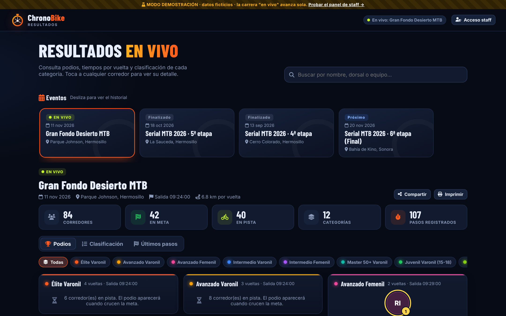
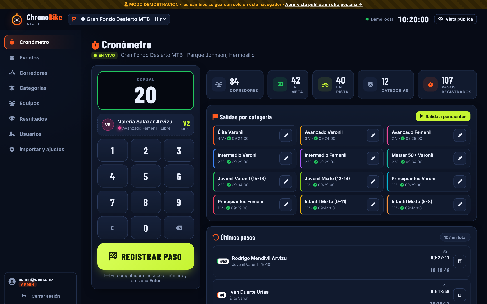

# 🚴⏱️ ChronoBike 2.0

**Cronometraje de circuitos y resultados en vivo.**
Una app web que se abre en cualquier celular o computadora, con dos caras:

| 👀 Vista pública (`index.html`) | 🛡️ Panel de staff (`admin.html`) |
|---|---|
| Podios, clasificación y tiempos por vuelta de eventos en vivo y anteriores. Solo lectura, sin cuenta. | Registro de eventos, corredores, equipos, categorías y **pasos por meta**. Requiere usuario. |
|  |  |

> **Pruébala ya, sin instalar nada:** abre `index.html` o `admin.html` con cualquier servidor estático.
> Sin configurar una base de datos, la app arranca en **modo demostración** con datos ficticios
> (4 eventos, 12 categorías, ~70-95 corredores). **Los datos son aleatorios y distintos cada vez que
> se entra al demo**, y la carrera "en vivo" siempre arranca al **50 % de avance** y sigue sola.
> Entra al panel con usuario `admin` y la contraseña `demo`.

```bash
npm start          # sirve la app en http://localhost:5173
```

```bash
npm test           # pruebas del motor de tiempos
```

## 📚 Documentación

| Documento | Para quién |
|---|---|
| [Presentación del proyecto y ventajas](docs/PRESENTACION.md) | Organizadores, patrocinadores, directivos |
| [Manual de usuario (con capturas)](docs/MANUAL_USUARIO.md) | Público, registradores y administradores |
| [Guías de entrenamiento](docs/GUIA_ENTRENAMIENTO.md) | Quien capacita al staff de cronometraje |
| [Base de datos y despliegue](docs/BASE_DE_DATOS_Y_DESPLIEGUE.md) | Quien instala y mantiene el sistema |

## 🧱 Estructura

```
index.html              Vista pública
admin.html              Panel de staff
tv.html                 Pantalla de TV para la meta (rotación por categoría + último paso + QR)
css/styles.css          Diseño visual (tema oscuro, responsivo, imprimible)
js/config.js            ← Aquí se pegan los datos de Supabase
js/store.js             Datos: modo demo (navegador) o Supabase (nube) + cola offline
js/results.js           Motor de cálculo de tiempos, posiciones y diferencias
js/views.js             Podio, tabla, detalle de corredor, feed de pasos
js/public.js, admin.js  Lógica de cada vista
js/demo-data.js         Generador de datos ficticios
supabase/schema.sql     Tablas, seguridad (RLS) y tiempo real
supabase/seed.sql       Los mismos datos ficticios para cargarlos en la nube
supabase/functions/staff  Función del servidor para crear cuentas del staff desde la app
docs/                   Presentación, manual, guías e imágenes
```

## 🚀 Puesta en marcha (resumen)

1. Crea un proyecto gratuito en [supabase.com](https://supabase.com) y ejecuta `supabase/schema.sql` en el **SQL Editor**.
2. Copia la **Project URL** y la clave **anon public** en `js/config.js`.
3. Publica la carpeta en [Netlify](https://app.netlify.com/drop): arrastra la carpeta, o conecta este repositorio.
4. Instala la función `supabase/functions/staff` (Supabase → Edge Functions → Via Editor, sin *Verify JWT*). Luego abre `admin.html`: la primera vez te pide crear la cuenta de administrador. Las demás cuentas se crean en **Usuarios**.
5. En el panel: **Importar y ajustes**. Ahí subes tu Excel actual (`CORREDORES`, `CATEGORIAS`, `Equipos`).

Detalle paso a paso en [docs/BASE_DE_DATOS_Y_DESPLIEGUE.md](docs/BASE_DE_DATOS_Y_DESPLIEGUE.md).
