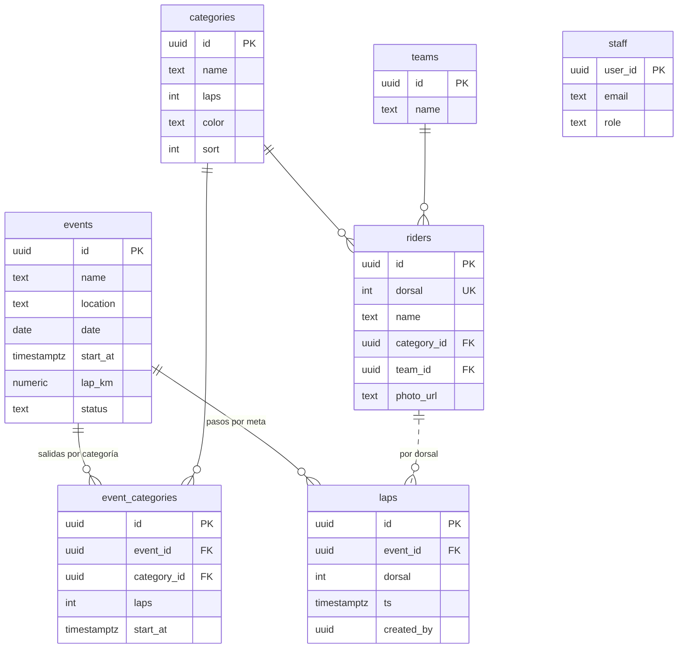

# 🗄️ Base de datos y despliegue

## 1. ¿Dónde hacer la base de datos? → **Supabase** (recomendado)

| Opción | Pros | Contras | Veredicto |
|---|---|---|---|
| **Supabase** (PostgreSQL) | Gratis para empezar. Base SQL real. **Usuarios y roles** incluidos. **Tiempo real** nativo. Seguridad por filas. Panel tipo Excel para ver datos. | Pausa proyectos gratuitos inactivos 7 días (se reactivan con un clic) | ✅ **Elegida** |
| Firebase (Firestore) | Tiempo real y modo offline muy buenos | NoSQL: los reportes y el SQL son más difíciles. Las reglas de seguridad son más complejas. | Buena alternativa |
| Google Sheets + Apps Script (actual) | Familiar, gratis | Lento, sin usuarios, límites de cuota, la URL queda expuesta, sin tiempo real | ❌ Se reemplaza |
| Servidor propio (MySQL + PHP/Node) | Control total | Hay que mantener y pagar un servidor | Innecesario por ahora |

La app ya viene preparada para Supabase: solo necesitas pegar 2 datos.

## 2. De tus tablas de Excel a la base de datos



| Hoja del Excel | Tabla nueva | Cambios |
|---|---|---|
| `EVENTOS` (id, name, date) | `events` | + sede, **hora de salida general**, km por vuelta, estado (próximo / en vivo / finalizado) |
| `CATEGORIAS` (id, name, laps, startTime) | `categories` | + color. ⚠️ **`startTime` se mueve** a `event_categories` porque cambia en cada evento. |
| — | `event_categories` **(nueva)** | Hora de salida y vueltas **de cada categoría en cada evento** |
| `Equipos` (id, name) | `teams` | Nombre único, sin importar mayúsculas |
| `CORREDORES` (dorsal, name, category, team, photo) | `riders` | Usa la categoría y el equipo por **ID** (no por texto). El dorsal es único. |
| `Registro` (id, eventId, eventName, dorsal, timestamp, dateTime) | `laps` | Una sola columna `ts` con fecha, hora y milisegundos. + quién registró. |
| `RESULTADOS` | *(se calcula)* | Ya no se guarda: se calcula al momento y siempre está correcto |
| — | `staff` **(nueva)** | Usuarios autorizados y su rol (se administran desde **Usuarios** en la app) |

El archivo completo está en [`supabase/schema.sql`](../supabase/schema.sql). Ya se probó en PostgreSQL 16: se puede ejecutar dos veces, el público no puede escribir y el registrador no puede crear eventos.

## 3. Crear la base de datos (10 minutos)

1. Entra a **https://supabase.com** → *Start your project* → inicia sesión con GitHub o correo.
2. **New project**: nombre `chronobike`, una contraseña segura (guárdala) y la región más cercana (ej. *West US*).
3. Menú izquierdo → **SQL Editor** → **New query** → pega **todo** `supabase/schema.sql` → **Run**.
   ✅ Debe decir *Success. No rows returned*.
4. *(Opcional, para practicar)* Nueva consulta → pega `supabase/seed.sql` → **Run**. Carga los mismos datos ficticios del demo.
5. **Project Settings → API**: copia
   - **Project URL** → `https://xxxx.supabase.co`
   - **anon public** key → `eyJhbGciOi...`
6. Pégalos en `js/config.js`:
   ```js
   SUPABASE_URL: 'https://xxxx.supabase.co',
   SUPABASE_ANON_KEY: 'eyJhbGciOi...',
   ```
   💡 La clave *anon* es pública por diseño. La seguridad la dan las políticas RLS del `schema.sql`. **Nunca** pongas la clave `service_role` en la app.

## 4. Crear usuarios del staff (desde la app)

Las cuentas se crean **dentro de ChronoBike**, no en Supabase. Para eso se instala una sola vez una pequeña función del servidor (`staff`). Esa función guarda la llave secreta que permite crear cuentas, así que la llave nunca llega al navegador.

### 4.1 Instalar la función `staff` (una sola vez, 3 min)
1. Supabase → menú izquierdo **Edge Functions** → **Deploy a new function** → **Via Editor**.
2. **Name:** `staff` (exactamente así).
3. Borra el código de ejemplo y pega **todo** el archivo [`supabase/functions/staff/index.ts`](../supabase/functions/staff/index.ts).
4. Haz clic en **Deploy function**.
5. Al terminar, entra a la función → **Settings (Details)** → **desactiva "Verify JWT with legacy secret"** (o *Enforce JWT Verification*) → **Save**.
   La función comprueba por sí misma quién la llama. Sin este cambio, la app no podrá usarla.

> Con la [CLI de Supabase](https://supabase.com/docs/guides/cli) es un solo comando:
> `supabase functions deploy staff --no-verify-jwt --project-ref TU_PROJECT_ID`

### 4.2 Crear el primer administrador
1. Abre `https://tu-sitio.netlify.app/admin.html`.
2. Como todavía no hay administradores, aparece **Configuración inicial**. Elige tu **usuario** (ej. `ricardo`) y una contraseña (mínimo 8 caracteres) → **Crear administrador y entrar**.
3. Esta pantalla **solo aparece una vez**. Cuando ya existe un administrador, nadie más puede usarla.

⚠️ Hazlo justo después de instalar la función, para que nadie se adelante.

### 4.3 Dar de alta al staff
En el panel → **Usuarios** → **Nuevo usuario** → **usuario** (ej. `juan`, `meta1`), contraseña (se genera una al azar) y rol → **Crear cuenta**.
Luego **Copiar** o **WhatsApp** para enviarle sus datos de acceso. Desde ahí también puedes cambiar el rol, cambiar la contraseña o eliminar la cuenta.

### 4.4 Recomendado
Supabase → **Authentication → Sign In / Providers → Email** → **desactiva "Allow new users to sign up"**. Así nadie se puede registrar por su cuenta. La función `staff` sigue pudiendo crear cuentas.

## 5. Publicar la página (Netlify)

**Opción rápida (arrastrar y soltar):**
1. Entra a **https://app.netlify.com/drop**.
2. Arrastra la carpeta del proyecto (la que contiene `index.html`).
3. ✅ Obtienes una URL tipo `https://nombre-aleatorio.netlify.app`. Cámbiala en *Site settings → Change site name*.

**Opción recomendada (conectada a GitHub, se actualiza sola):**
1. Netlify → *Add new site → Import an existing project → GitHub* → elige `chronobike`.
2. Build command: *(vacío)*. Publish directory: `.`. **Deploy**.
3. Cada vez que se suba un cambio al repositorio, el sitio se actualiza.

**Alternativas equivalentes:** Vercel, Cloudflare Pages o GitHub Pages. Es un sitio 100 % estático.

**Dominio propio (opcional):** *Domain management → Add a domain* (ej. `resultados.miserial.mx`).

| URL | Para |
|---|---|
| `https://tu-sitio.netlify.app/` | Público (compártela) |
| `https://tu-sitio.netlify.app/admin.html` | Staff |

## 6. Migrar tus datos actuales
1. Entra a `admin.html` como admin → **Importar y ajustes**.
2. Arrastra tu `chronobike.xlsx`. Se leen las hojas **CORREDORES**, **CATEGORIAS** y **Equipos**.
3. Revisa los conteos → **Importar ahora**.
4. Ve a **Categorías** y asigna colores y vueltas. Las salidas se dan en cada evento.

> Los pasos antiguos (hoja `Registro`) no se importan porque sus horas de salida eran incorrectas y no se pueden reconstruir con confianza.

## 7. Desarrollo local

```bash
npm start
```

```bash
npm test
```

```bash
npm run seed:sql
```

```bash
npm run screenshots
```

`npm start` sirve la app en http://localhost:5173. `npm test` corre las pruebas del motor de tiempos. `npm run seed:sql` regenera `supabase/seed.sql` desde `js/demo-data.js`. `npm run screenshots` regenera las capturas de `docs/img` (requiere Playwright y que `npm start` esté corriendo).

## 8. Mantenimiento
- **Respaldo:** después de cada evento, en *Importar y ajustes → Descargar respaldo*. Supabase también hace respaldos diarios en planes de pago.
- **Proyecto pausado** (plan gratuito): entra al panel de Supabase → *Restore project*.
- **Ver o editar datos a mano:** Supabase → *Table Editor* (parecido a Excel).
- **Reporte rápido en SQL:** la vista `laps_detalle` une pasos, corredor, categoría y equipo.
