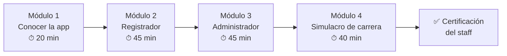
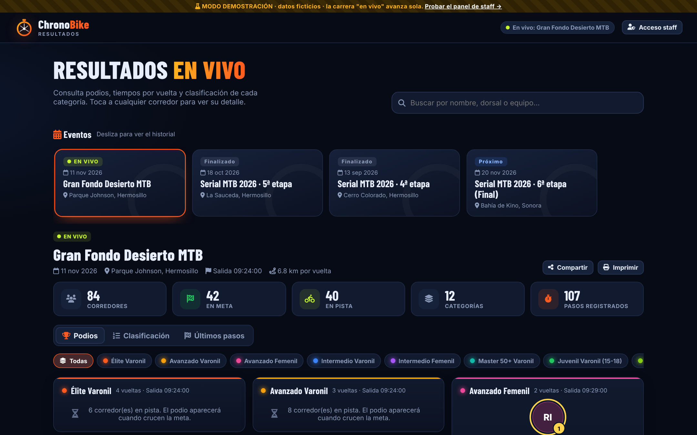
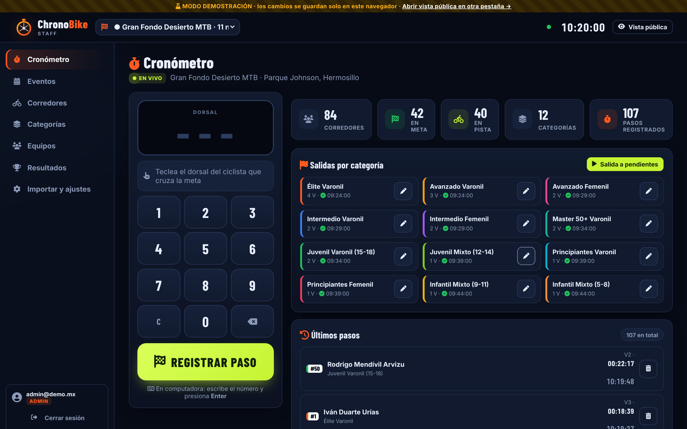
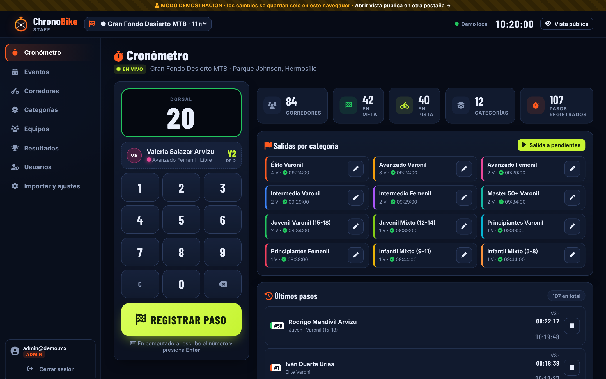
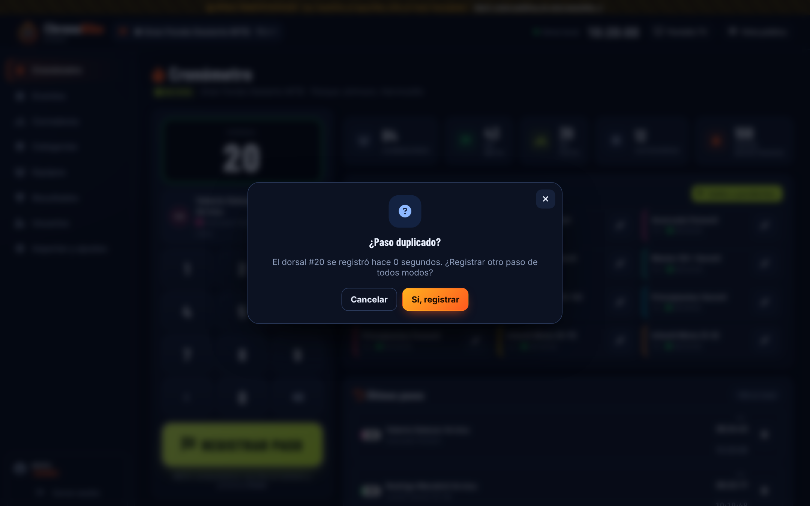
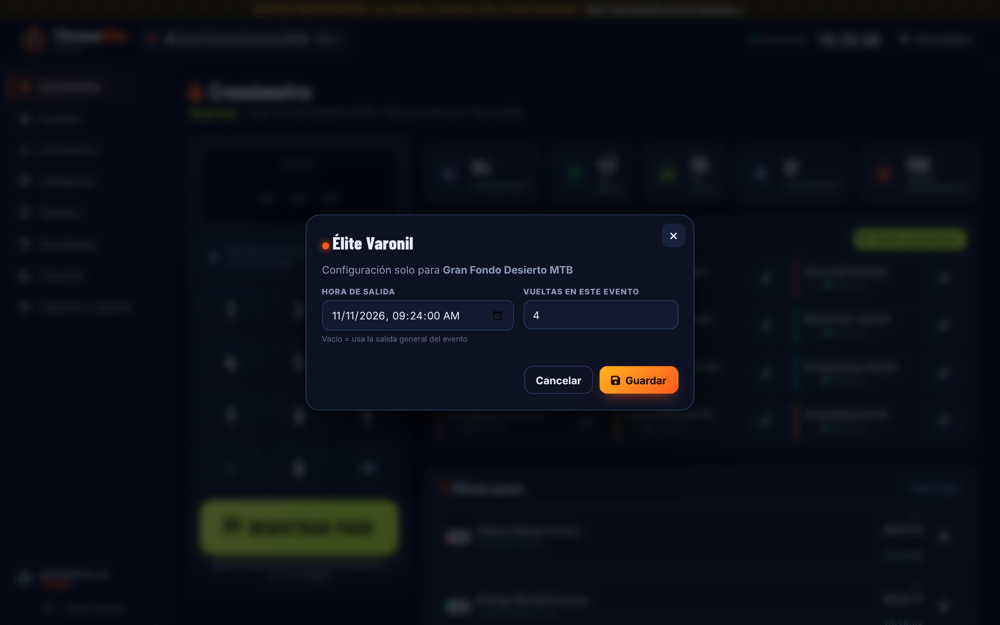
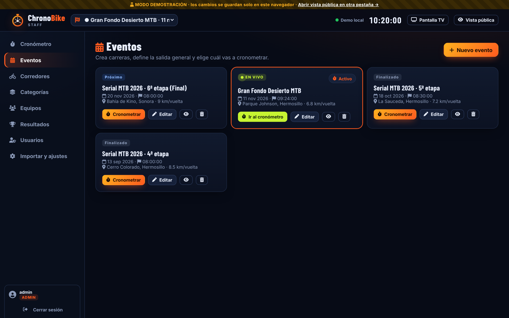

# 🎓 Guías de entrenamiento · ChronoBike 2.0

Programa para capacitar al staff **sin riesgo**: todo se practica en el **modo demostración**, con datos ficticios.



| Módulo | Quién lo toma | Duración |
|---|---|---|
| 1 · Conocer la app | Todo el staff | 20 min |
| 2 · Registrador | Registradores y administradores | 45 min |
| 3 · Administrador | Solo administradores | 45 min |
| 4 · Simulacro | Todo el staff junto | 40 min |

## 🧰 Preparación del instructor
- [ ] Un celular por participante y una laptop con proyector.
- [ ] Abrir la app **en modo demo** (sin `SUPABASE_URL` en `js/config.js`), o la URL de práctica.
- [ ] Imprimir la [tarjeta de bolsillo](#-tarjeta-de-bolsillo-imprimir) para cada registrador.
- [ ] Imprimir 20 "dorsales" de papel con los números 1 a 20, más el 150 (no registrado).
- [ ] En cada celular: **Ajustes → Fecha y hora → Automática**.

💡 Para reiniciar la práctica: **Importar y ajustes → Restablecer datos de demostración**.

---

## Módulo 1 · Conocer la app (20 min)

**Objetivo:** que todos sepan qué ve el público y qué ve el staff.

| Min | Actividad |
|---|---|
| 0–5 | Explica las **dos caras** de la app: pública (`index.html`) y staff (`admin.html`) |
| 5–12 | Cada participante abre la vista pública y explora el evento **EN VIVO** |
| 12–20 | Ejercicios 1.1 a 1.4 |



**Ejercicios**
1. **1.1** ¿Quién ganó *Élite Varonil* en la *5ª etapa*? ¿Con qué tiempo? → *Toca el evento → Podios*.
2. **1.2** Busca el equipo *Halcones MTB*. ¿Cuántos corredores aparecen?
3. **1.3** Abre la ficha del ganador de *Élite Varonil*. ¿Cuál fue su mejor vuelta?
4. **1.4** Agrega la app a la pantalla de inicio del celular.

✅ **Lo logró si:** encuentra un podio, una ficha y un corredor por búsqueda en menos de 1 minuto cada uno.

---

## Módulo 2 · Registrador (45 min)

**Objetivo:** registrar pasos rápido y sin errores, y saber resolver los avisos.

### 2.A Entrar (5 min)
Entra con `registro@demo.mx` / `demo`. Revisa el **evento activo** y el **punto de sincronización**.



### 2.B La regla de oro (10 min)

> ### 🔢 TECLEA → 👀 MIRA EL NOMBRE → 👆 REGISTRA
> La hora se toma **al tocar REGISTRAR**. Toca en cuanto la rueda delantera cruza la línea.



**Ejercicio 2.1 · "Lluvia de dorsales"** (en parejas). Uno muestra un dorsal de papel y el otro lo registra. 10 dorsales cada uno y luego cambian.
- Meta: **menos de 3 segundos** entre ver el dorsal y escuchar el bip.
- Revisa en **Últimos pasos** que sean los correctos.

**Ejercicio 2.2 · Llegada en grupo.** Muestra 3 dorsales a la vez. El registrador los captura en el orden de cruce, sin detenerse.

### 2.C Los avisos (10 min)

| Ejercicio | Qué hacer | Respuesta correcta |
|---|---|---|
| **2.3** Doble toque | Registra el mismo dorsal 2 veces seguidas | Sale *¿Paso duplicado?* → **Cancelar** |
| **2.4** Dorsal desconocido | Registra el **150** | Pantalla amarilla. Se registra de todos modos y se avisa al admin. |
| **2.5** Ya terminó | Registra un corredor con 🏁 | Sale *Ya terminó* → **Cancelar**, salvo que el juez indique otra cosa |



### 2.D Corregir (5 min)
**Ejercicio 2.6:** registra el dorsal 7 "por error" y bórralo desde **Últimos pasos → 🗑️**. Comprueba en la vista pública que desapareció.

### 2.E Salidas (10 min)
**Ejercicio 2.7:** en ✏️ de *Infantil Mixto (5-8)*, cambia la salida 2 minutos antes y guarda. Observa cómo cambian los tiempos en **Resultados**. Luego regrésala.



### 2.F Sin internet (5 min)
**Ejercicio 2.8** (con la app conectada a Supabase de pruebas): activa el **modo avión**, registra 3 pasos y verifica 🔴 *3 pendientes*. Desactiva el modo avión y verifica 🟢.

✅ **Certificación del registrador:** 20 pasos seguidos sin error, en menos de 3 s cada uno, y resolver correctamente los ejercicios 2.3, 2.4 y 2.6.

---

## Módulo 3 · Administrador (45 min)

Entra con `admin@demo.mx` / `demo`.

| # | Ejercicio | Pantalla |
|---|---|---|
| 3.1 | Crea el evento **"Práctica · Etapa 1"** para hoy a las 09:00 con 6 km por vuelta | Eventos → Nuevo evento |
| 3.2 | Vuélvelo **activo** (👆 Cronometrar) | Eventos |
| 3.3 | Crea la categoría **"Gravel Mixto"**, 2 vueltas, color morado | Categorías |
| 3.4 | Inscribe 3 corredores en *Gravel Mixto*. A uno ponle el equipo `halcones mtb` (en minúsculas) y comprueba que se unió a *Halcones MTB* | Corredores |
| 3.5 | Da salida a *Gravel Mixto* y registra 2 vueltas a cada corredor | Cronómetro |
| 3.6 | Revisa el podio, exporta el CSV y ábrelo en Excel | Resultados |
| 3.7 | Cierra el evento y verifica que en la vista pública aparece como **Finalizado** | Resultados → Cerrar evento |
| 3.8 | Importa el Excel del serial (hojas CORREDORES / CATEGORIAS / Equipos) | Importar y ajustes |
| 3.9 | Descarga un respaldo JSON | Importar y ajustes |
| 3.11 | Abre la **Pantalla TV** en otra ventana, registra un paso en el Cronómetro y comprueba que aparece en grande | Pantalla TV |
| 3.10 | Crea una cuenta de **registrador** para un compañero, envíale sus datos por WhatsApp, pídele que entre y luego cámbiale la contraseña | Usuarios |



✅ **Certificación del administrador:** completa del 3.1 al 3.7 en menos de 20 minutos y sin ayuda.

---

## Módulo 4 · Simulacro de carrera (40 min)

Reproduce un día real. Roles:

| Rol | Persona | Tarea |
|---|---|---|
| 🎙️ Juez de salida | Instructor | Grita "¡Salida Élite!", "¡Salida Infantil!"… |
| ⏱️ Registrador A | Participante | Registra dorsales del 1 al 10 |
| ⏱️ Registrador B | Participante | Registra dorsales del 11 al 20 (otro celular, mismo evento) |
| 🛠️ Admin | Participante | Da las salidas e inscribe a un "corredor de último minuto" |
| 👀 Público | Resto del grupo | Vigila la vista pública en el proyector |

**Guion**

| Min | Evento |
|---|---|
| 0 | Admin crea "Simulacro" y lo marca **EN VIVO** |
| 2 | 🎙️ Salida de la categoría A → Admin ▶ |
| 4 | 🎙️ Salida de la categoría B → Admin ▶ |
| 6–30 | El instructor "hace pasar" dorsales de papel cada 5 a 20 s, a veces 3 juntos |
| 12 | Aparece el dorsal **150** → el registrador lo captura y el admin lo inscribe |
| 18 | El instructor provoca un doble toque → se debe cancelar |
| 22 | Se corta el Wi-Fi de un registrador 2 minutos |
| 30 | Últimas vueltas → revisar podios en el proyector |
| 35 | Admin exporta resultados, cierra el evento y descarga el respaldo |
| 40 | Retroalimentación |

✅ **Simulacro aprobado si:** el podio del proyector coincide con la hoja del instructor y no hubo pasos perdidos ni duplicados.

---

## 📋 Checklists del día de carrera

### Un día antes (admin)
- [ ] Evento creado, con fecha, hora de salida general y km por vuelta.
- [ ] Corredores importados o inscritos, sin dorsales repetidos.
- [ ] Vueltas de cada categoría revisadas (✏️ en el Cronómetro si cambian para este evento).
- [ ] Cuentas del staff creadas en **Usuarios** y probadas (cada quien entró una vez).
- [ ] Abrir el panel de Supabase (para que no se pause el proyecto gratuito).

### En la meta, 30 minutos antes (registradores)
- [ ] Batería al 100 % y una batería externa.
- [ ] Hora automática activada.
- [ ] Sesión iniciada, **evento correcto** seleccionado y punto 🟢.
- [ ] Brillo al máximo y sonido activado.
- [ ] Prueba: registra el dorsal de prueba y **bórralo**.
- [ ] TV o proyector en la meta con `tv.html` en pantalla completa (tecla **F**).

### En la salida (admin)
- [ ] ▶ en el instante del disparo de cada categoría.
- [ ] Si se te pasó: ✏️ y la hora exacta (anótala en papel como respaldo).

### Al terminar (admin)
- [ ] Revisar la columna **Progreso**: ¿alguien con vueltas de menos por error?
- [ ] Revisar pasos *"no cuenta"* y dorsales no registrados.
- [ ] **Cerrar evento**, **exportar CSV** y **descargar respaldo**.
- [ ] Compartir el enlace de resultados.

---

## 🚑 Errores comunes y solución rápida

| Síntoma | Causa probable | Solución |
|---|---|---|
| Tiempos enormes o negativos | Salida mal capturada | ✏️ en la categoría → corregir la hora |
| El corredor no sale en la tabla | Dorsal no inscrito o sin categoría | Corredores → inscribir o editar |
| "SIN SALIDA" | La categoría y el evento no tienen hora de salida | Dar salida (▶) o editar la salida general del evento |
| El público no ve los cambios | Sin internet en el registrador | Ver el punto de color. Los pasos se envían solos al volver la señal. |
| "Tu usuario no está dado de alta como staff" | La cuenta no está en Usuarios | El admin la crea en **Usuarios → Nuevo usuario** |
| Olvidé mi contraseña | — | El admin entra a **Usuarios → 🔑** y pone una nueva |
| Equipos repetidos | Datos antiguos | Equipos → renombrar o eliminar el duplicado y reasignar |

---

## ✂️ Tarjeta de bolsillo (imprimir)

```
┌─────────────────────────────────────────────┐
│  CHRONOBIKE · REGISTRADOR                   │
│                                             │
│  1. 🔢 Teclea el dorsal                     │
│  2. 👀 Verifica nombre y vuelta (verde)     │
│  3. 👆 REGISTRAR PASO  → bip + vibración    │
│                                             │
│  C = borrar todo     ⌫ = borrar un dígito   │
│  Amarillo = dorsal no inscrito (regístralo) │
│  ¿Duplicado? → Cancelar si fue doble toque  │
│  Error → Últimos pasos → 🗑️                 │
│                                             │
│  🟢 sincronizado  🟡 enviando  🔴 sin red    │
│  Sin red: SIGUE REGISTRANDO, no cierres.    │
└─────────────────────────────────────────────┘
```

## 📝 Evaluación rápida (10 preguntas)
1. ¿En qué momento se toma la hora del paso? *(Al tocar REGISTRAR)*
2. ¿Qué color indica un dorsal no inscrito? *(Amarillo)*
3. ¿Qué haces si se va el internet? *(Seguir registrando y no cerrar sesión)*
4. ¿Dónde se corrige la hora de salida de una categoría? *(Cronómetro → ✏️)*
5. ¿Cuenta un paso después de completar las vueltas? *(No)*
6. ¿Cómo se borra un paso equivocado? *(Últimos pasos → 🗑️)*
7. ¿Qué rol puede crear eventos? *(Admin)*
8. ¿Qué pasa si escribes un equipo con otras mayúsculas? *(Se une al existente)*
9. ¿Cómo se calcula el tiempo oficial? *(Última vuelta requerida menos la salida)*
10. ¿Qué se hace al terminar el evento? *(Cerrar, exportar y respaldar)*

Aprobado con **8/10**.
