# 📘 Manual de usuario · ChronoBike 2.0

> Este manual tiene **3 partes**. Ve directo a la tuya:
>
> | | Parte | Para |
> |---|---|---|
> | 👀 | [A. Ver resultados](#parte-a--ver-resultados-público) | Corredores, familias, público |
> | ⏱️ | [B. Cronometrar una carrera](#parte-b--cronometrar-registrador) | Registradores en la meta |
> | 🛠️ | [C. Administrar](#parte-c--administrar-administrador) | Organizadores |
>
> Todas las imágenes usan **datos ficticios** del modo demostración.

### Símbolos de este manual
| Símbolo | Significa |
|:-:|---|
| 👆 | Toca o haz clic |
| ✅ | Resultado esperado |
| ⚠️ | Cuidado |
| 💡 | Consejo |

### Colores de estado
| Etiqueta | Significado |
|---|---|
| 🟢 **META** | Completó todas sus vueltas. Tiene tiempo oficial. |
| 🟡 **EN PISTA** | Lleva al menos una vuelta y sigue corriendo. |
| ⚪ **SIN PASO** | Todavía no cruza la meta (o no se presentó). |
| 🟢 `00:17:23` en verde lima | Su **mejor vuelta**. |

---

## PARTE A · Ver resultados (público)

### A1. Abrir la app
Abre en tu celular el enlace que comparte el organizador (ejemplo: `https://tu-serial.netlify.app`). No necesitas cuenta ni descargar nada.

💡 En el celular: menú del navegador → **"Agregar a pantalla de inicio"**. Así queda como una app.

Al abrir la app aparece por unos segundos la **pantalla de carga**: un ciclista sube pedaleando por un circuito de montaña mientras se cargan los datos. La barra de arriba muestra el avance real, y al llegar a la bandera 🏁 (100 %) se abre la app.

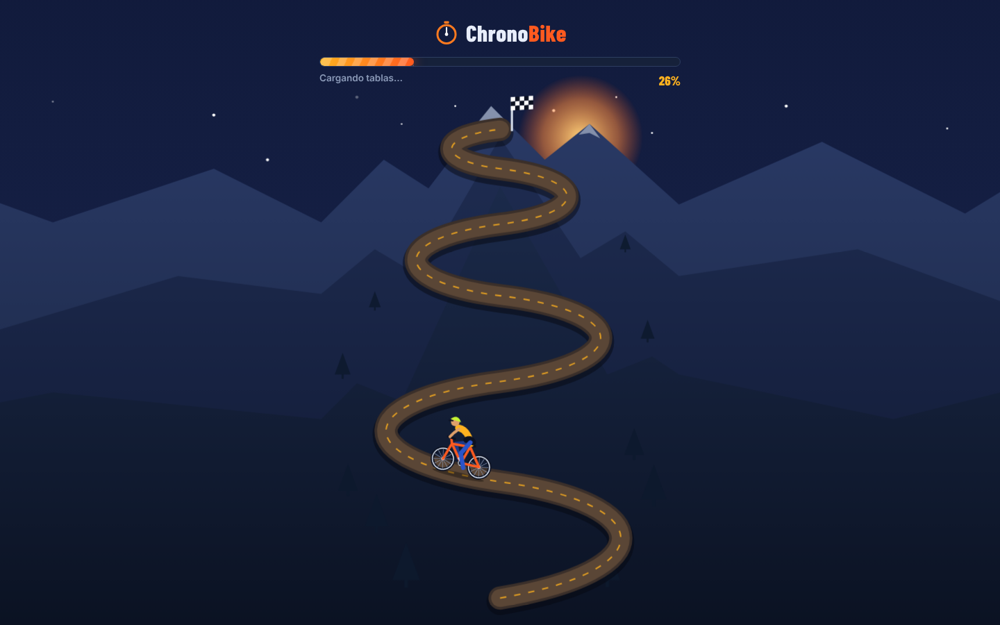

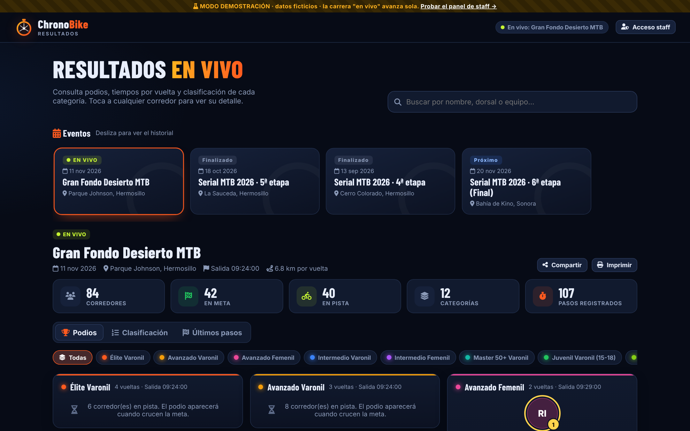

| # | Zona | Para qué sirve |
|:-:|---|---|
| 1 | **Buscador** (arriba a la derecha) | Encuentra a un corredor por nombre, dorsal o equipo |
| 2 | **Eventos** (tarjetas) | El que dice **EN VIVO** está ocurriendo ahora. Desliza para ver los anteriores y los próximos. |
| 3 | **Resumen** | Corredores inscritos, en meta, en pista, categorías y pasos registrados |
| 4 | **Podios / Clasificación / Últimos pasos** | Tres formas de ver el evento |
| 5 | **Categorías** (botones de colores) | Filtra una sola categoría |

### A2. Ver los podios 🏆
👆 Toca **Podios**. Cada categoría muestra a sus 3 primeros con medalla 🥇🥈🥉, tiempo oficial y diferencia con el ganador.

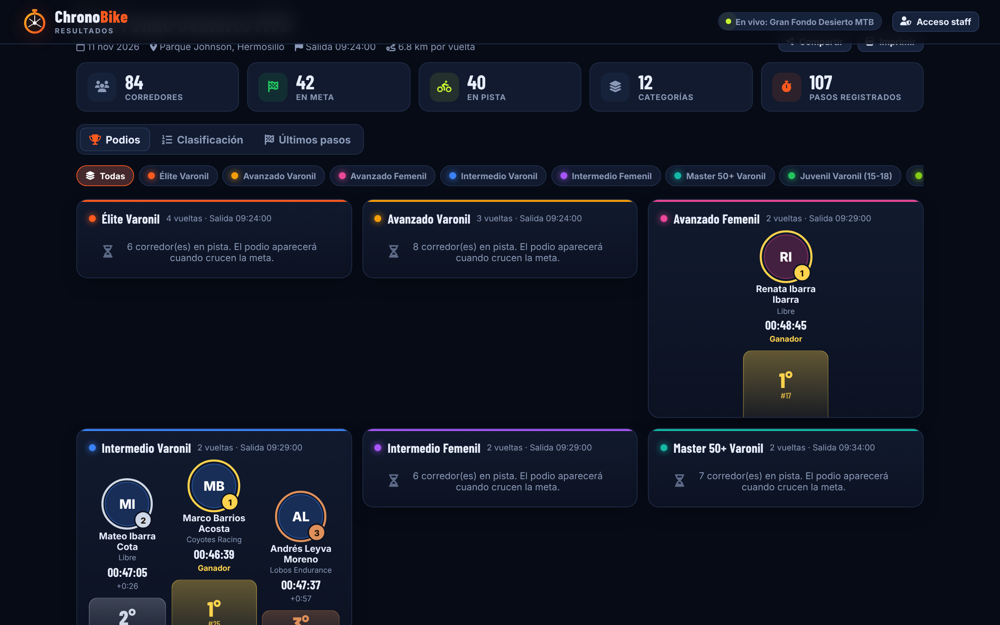

✅ Si la carrera sigue en curso, verás *"X corredor(es) en pista. El podio aparecerá cuando crucen la meta"*.

### A3. Ver eventos anteriores 📅
👆 Toca la tarjeta de un evento **Finalizado**. Toda la página cambia a ese evento.

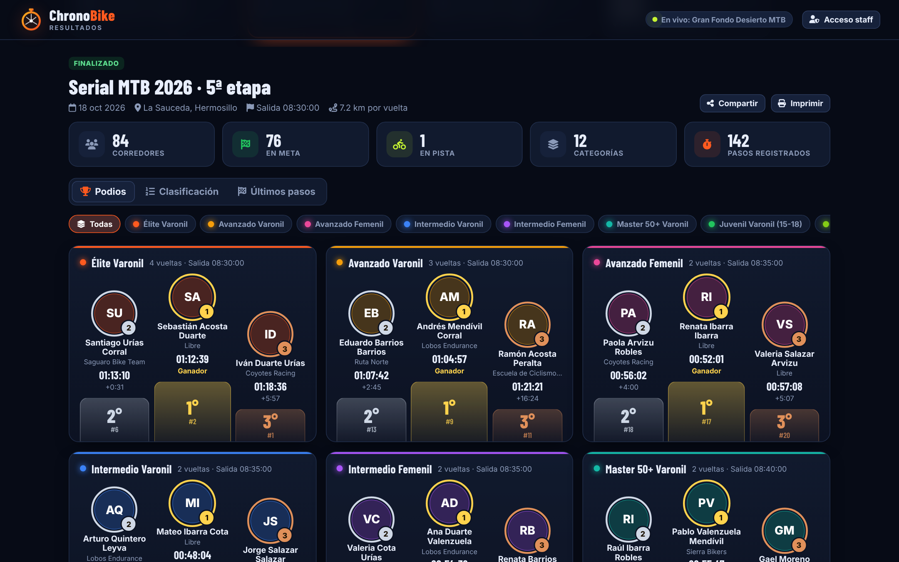

### A4. Clasificación completa 📊
👆 Toca **Clasificación** y elige una categoría.

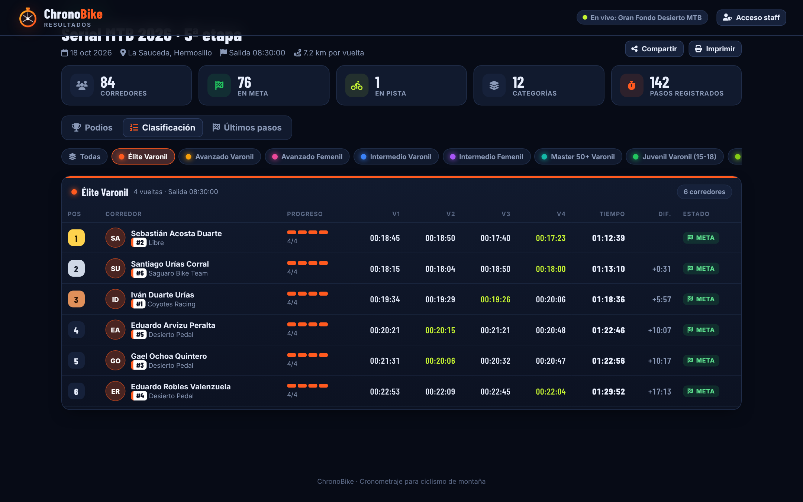

| Columna | Qué significa |
|---|---|
| **Pos** | Lugar en su categoría (oro, plata y bronce resaltados) |
| **Corredor** | Nombre, dorsal y equipo |
| **Progreso** | Barritas: vueltas hechas contra vueltas requeridas |
| **V1, V2…** | Tiempo de cada vuelta |
| **Tiempo** | Tiempo oficial (desde la salida hasta su última vuelta válida) |
| **Dif.** | Cuánto le falta para alcanzar al primer lugar |

### A5. Ficha de un corredor 👤
👆 Toca a cualquier corredor, en el podio o en la tabla.

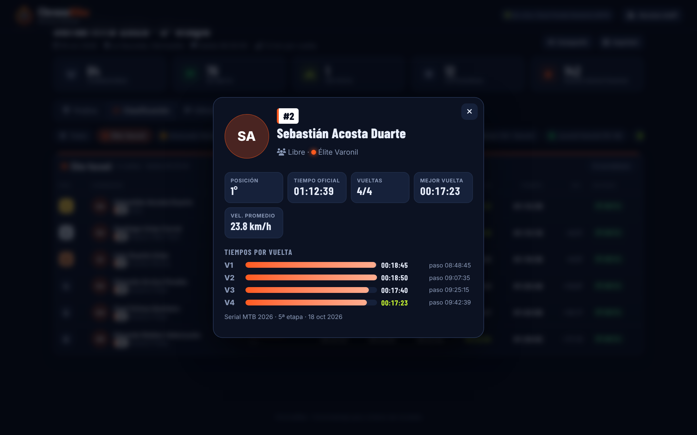

✅ Verás posición, tiempo oficial, mejor vuelta, velocidad promedio y una gráfica de barras de cada vuelta con la hora en que cruzó la meta.

### A6. Buscar 🔎
Escribe en el buscador: un nombre (`Lucía`), un dorsal (`25`) o un equipo (`Halcones`).

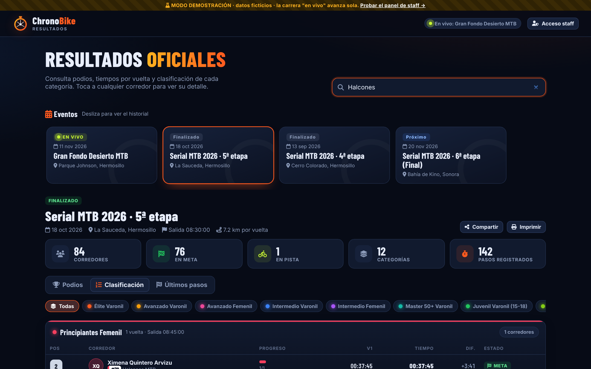

### A7. Últimos pasos por meta 🏁
👆 Toca **Últimos pasos** para ver quién va cruzando la meta, en tiempo real.

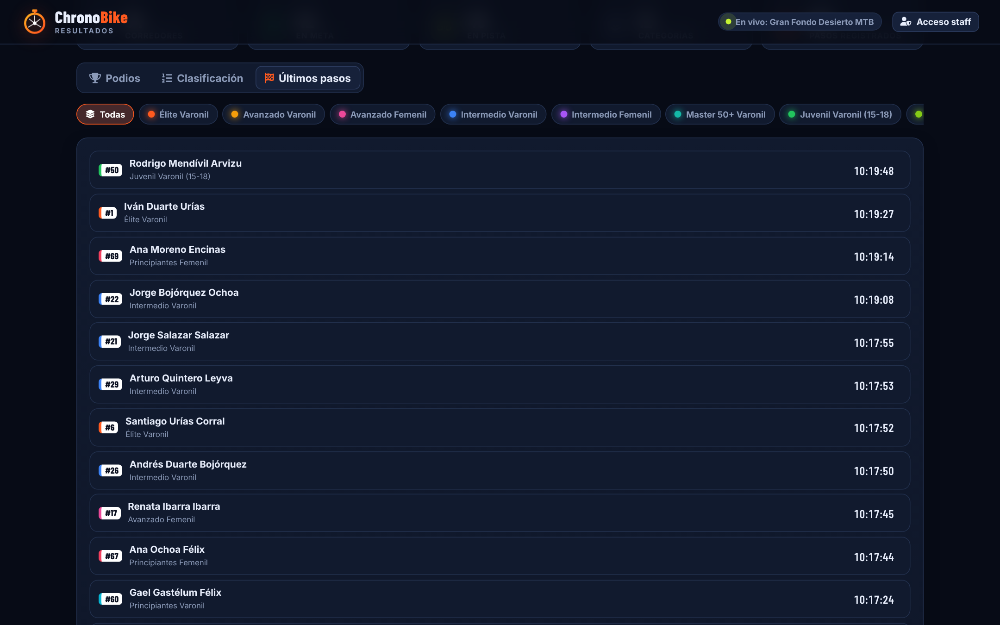

### A8. Compartir e imprimir
- 👆 **Compartir**: envía el enlace del evento por WhatsApp. Se abre directo en ese evento y esa categoría.
- 👆 **Imprimir**: genera una hoja limpia para imprimir o guardar en PDF.

### A9. En el celular 📱
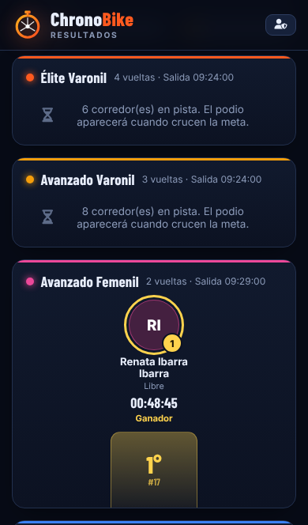

---

## PARTE B · Cronometrar (registrador)

### B1. Entrar
👆 **Acceso staff** (arriba a la derecha), o abre directamente `.../admin.html`.

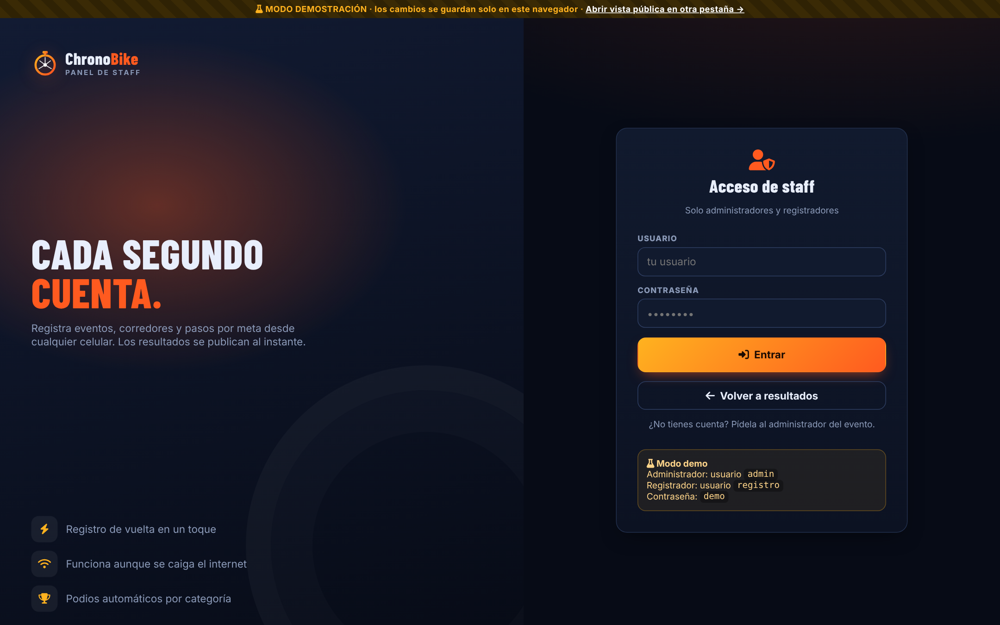

1. Escribe tu **usuario** y tu **contraseña** (te los da el administrador).
2. 👆 **Entrar**.

⚠️ Si aparece *"Tu usuario no está dado de alta como staff"*, pide al administrador que te agregue.
💡 En el **modo demo**: usuario `registro` o usuario `admin`, contraseña `demo`.

### B2. La pantalla del cronómetro
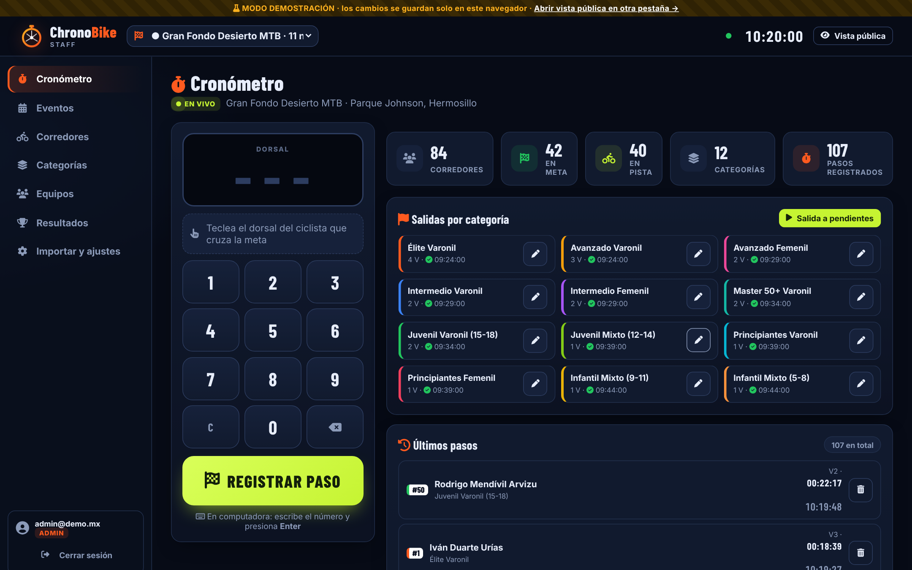

| Zona | Qué es |
|---|---|
| Arriba, **selector de evento** | Qué carrera estás cronometrando. ⚠️ Revisa que sea la correcta. |
| Arriba, **reloj** | Hora del teléfono. Todos los pasos usan esta hora. |
| Arriba, **punto de color** | 🟢 Sincronizado · 🟡 Enviando pendientes · 🔴 Sin conexión |
| Izquierda, **pantalla DORSAL + teclado** | Donde registras |
| Derecha, **Salidas por categoría** | Hora de salida de cada categoría |
| Derecha, **Últimos pasos** | Lo último registrado, con su vuelta y tiempo |

### B3. Dar la salida 🏁 (antes de que arranquen)
Cada categoría necesita su **hora de salida**. Hay 3 formas:

| Situación | Qué hacer |
|---|---|
| Todas salen juntas | 👆 **Salida a pendientes** justo en el disparo. Se aplica a todas las categorías que aún no tienen salida. |
| Salen por oleadas | 👆 el botón ▶ naranja de **cada categoría** en el momento de su salida |
| Se te pasó o fue a otra hora | 👆 ✏️ de la categoría y escribe la hora exacta |

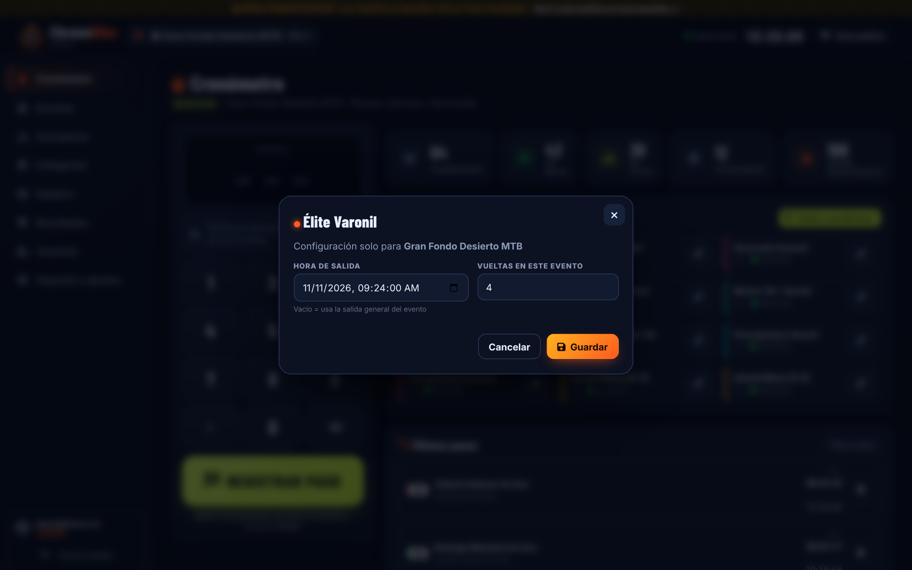

✅ La categoría muestra ✅ y la hora: `4 V · ✅ 09:24:00`.
💡 Si una categoría no tiene salida propia, se usa la **salida general** del evento.
💡 En ✏️ también puedes cambiar **cuántas vueltas** tiene esa categoría **solo en este evento**.

### B4. Registrar un paso por meta ⏱️ (lo más importante)

**Paso 1.** Cuando el ciclista cruce la meta, teclea su **dorsal**.

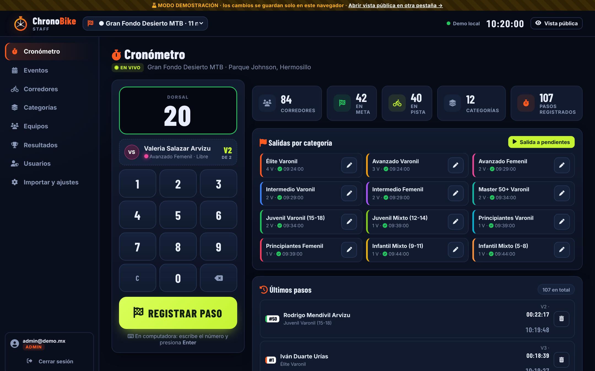

✅ La pantalla se pone **verde** y te muestra **quién es**, su categoría y **qué vuelta va a registrar** (`V2 de 2`).

**Paso 2.** 👆 **REGISTRAR PASO** (o presiona `Enter` en computadora).

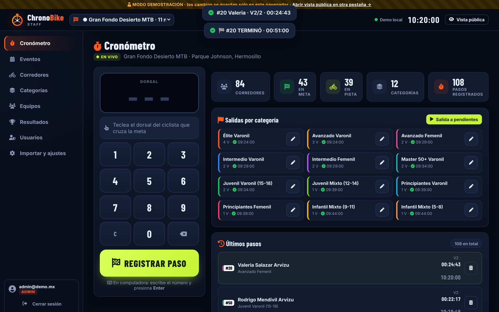

✅ Suena un **bip fuerte (doble)**, el celular **vibra con fuerza** y aparece arriba: `#20 Valeria · V2/2 · 00:24:43`.

| Aviso | Sonido | Vibración |
|---|---|---|
| Paso registrado | 2 bips agudos | 2 pulsos fuertes |
| **TERMINÓ** (completó sus vueltas) | 4 bips ascendentes | Patrón largo |
| Dorsal no inscrito / sin dorsal | Zumbido grave y largo | 1 pulso largo |
| Salida dada | 2 tonos | 1 pulso |

🔔 **Probar:** el botón de campana (arriba a la derecha) hace sonar y vibrar el celular. Pruébalo antes de empezar.
⚠️ Si no se oye, **sube el volumen multimedia** del celular. En **iPhone** apaga el modo silencio; además, el iPhone **no vibra** desde el navegador (en Android sí).
✅ Si completó su última vuelta aparece **🏁 TERMINÓ** con su tiempo oficial.
✅ El paso aparece primero en **Últimos pasos** y, en 1 o 2 segundos, en los celulares del público.

💡 **La hora se toma en el momento en que tocas REGISTRAR**, no cuando confirmas un aviso. Si ves llegar a varios juntos, teclea y registra uno por uno sin pausa.

| Botón | Hace |
|---|---|
| `C` | Borra todo el número |
| ⌫ | Borra el último dígito |

### B5. Avisos que puedes ver ⚠️

**Paso duplicado.** El mismo dorsal se registró hace menos de 30 segundos:

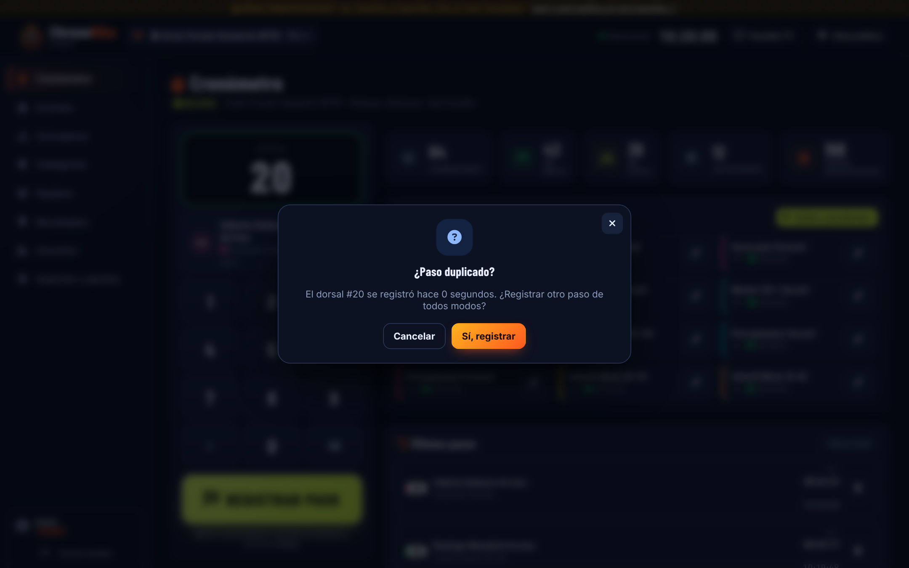

- Si fue un doble toque, 👆 **Cancelar**.
- Si de verdad volvió a pasar, 👆 **Sí, registrar**.

**Dorsal no registrado.** La pantalla se pone **amarilla**:

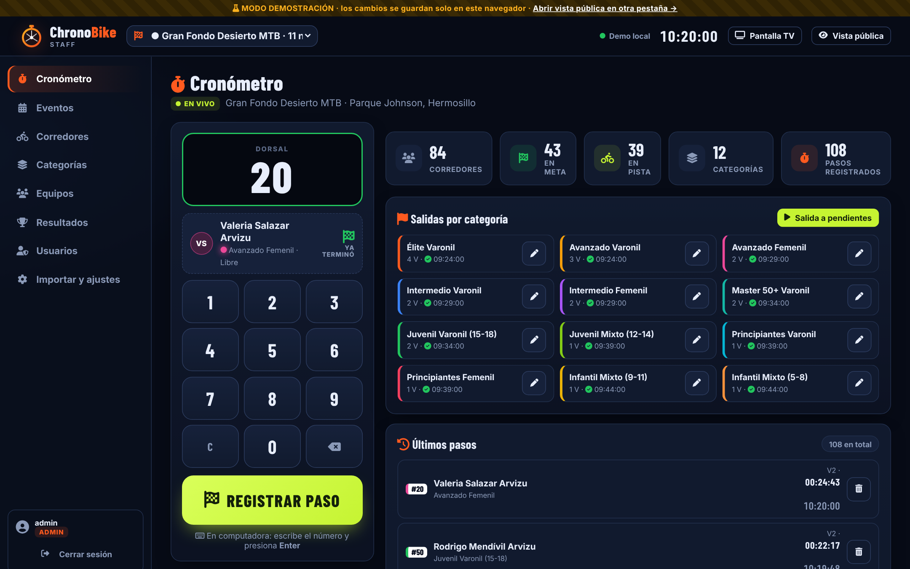

Puedes registrar el paso de todos modos; **no se pierde**. Después, da de alta al corredor con ese dorsal (sección B7) y su tiempo aparecerá solo.

**Ya terminó.** El corredor ya completó todas sus vueltas. Un paso extra **no cuenta** para el tiempo oficial.

### B6. Corregir un error 🗑️
En **Últimos pasos**, 👆 el bote de basura del paso equivocado y confirma.
✅ Los tiempos se recalculan solos.

### B7. Inscribir un corredor el día de la carrera
👆 **Corredores** → **Inscribir corredor**.

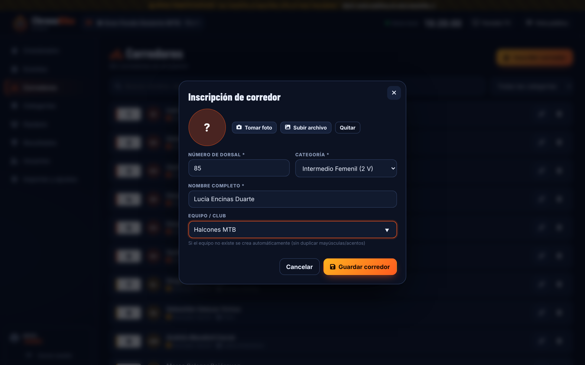

1. **Dorsal**: la app sugiere el siguiente libre.
2. **Categoría** y **Nombre completo** (obligatorios).
3. **Equipo**: escribe o elige uno. Si no existe, se crea. Si se escribe distinto (`HALCONES mtb`), se une al equipo existente.
4. **Foto** (opcional): 👆 **Tomar foto** usa la cámara.
5. 👆 **Guardar corredor**.

### B8. En el celular 📱
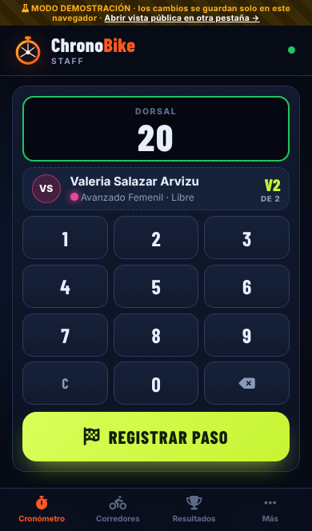 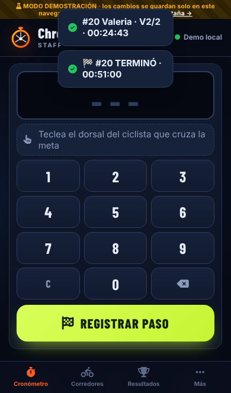

Menú inferior: **Cronómetro · Corredores · Resultados · Más**. En **Más** puedes cambiar de evento y cerrar sesión.

### B9. ¿Y si se va el internet? 📶
**Sigue registrando normal.** Cada paso se guarda en el teléfono y el indicador pasa a 🔴 *Sin conexión · 3 pendientes*. Al volver la señal se envían solos (🟡 → 🟢).
⚠️ **No cierres sesión ni borres los datos del navegador** mientras haya pendientes.

---

## PARTE C · Administrar (administrador)

El administrador ve, además: **Eventos, Categorías, Equipos, Usuarios e Importar y ajustes**.

### C1. Eventos 📅
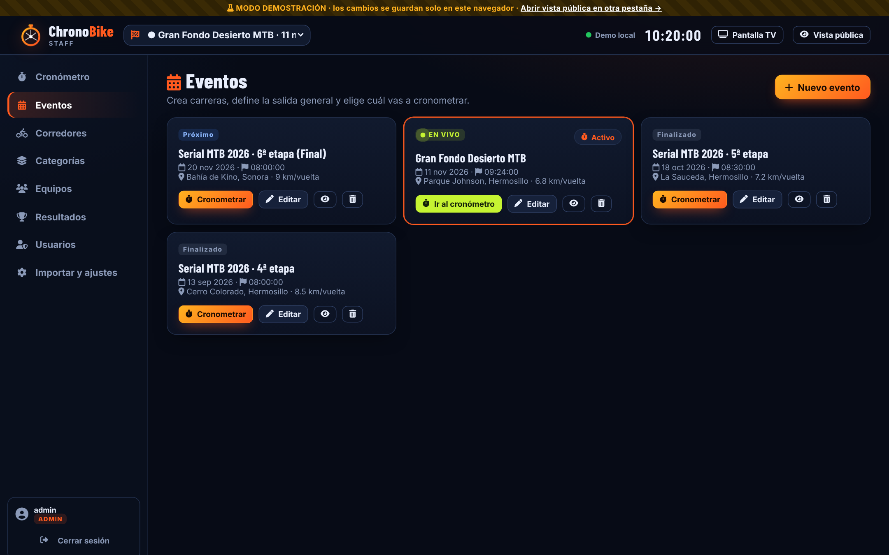

- 👆 **Nuevo evento**: nombre, sede, fecha, **hora de salida general**, km por vuelta (para la velocidad) y estado.
- 👆 **Cronometrar**: lo vuelve el evento activo de **este dispositivo**.
- 👁️ abre la vista pública de ese evento.

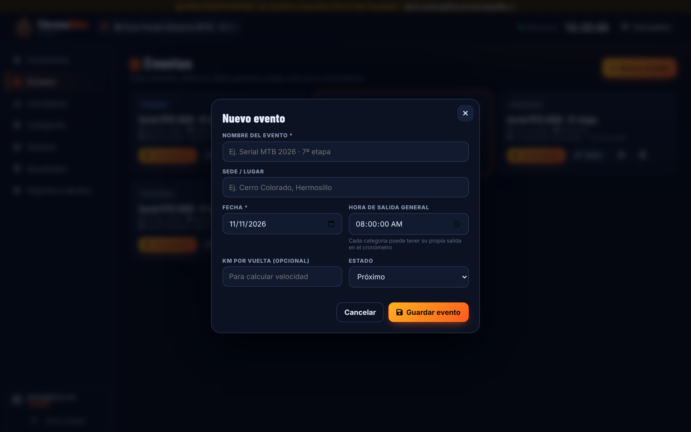

| Estado | Qué pasa en la vista pública |
|---|---|
| **Próximo** | Aparece como próximo, con su fecha y hora |
| **EN VIVO** | Aparece primero, con el indicador pulsante |
| **Finalizado** | Pasa al historial |

💡 El día de la carrera: en el Cronómetro, 👆 **Marcar evento EN VIVO**. Al terminar: **Resultados → Cerrar evento**.

### C2. Corredores 🚴
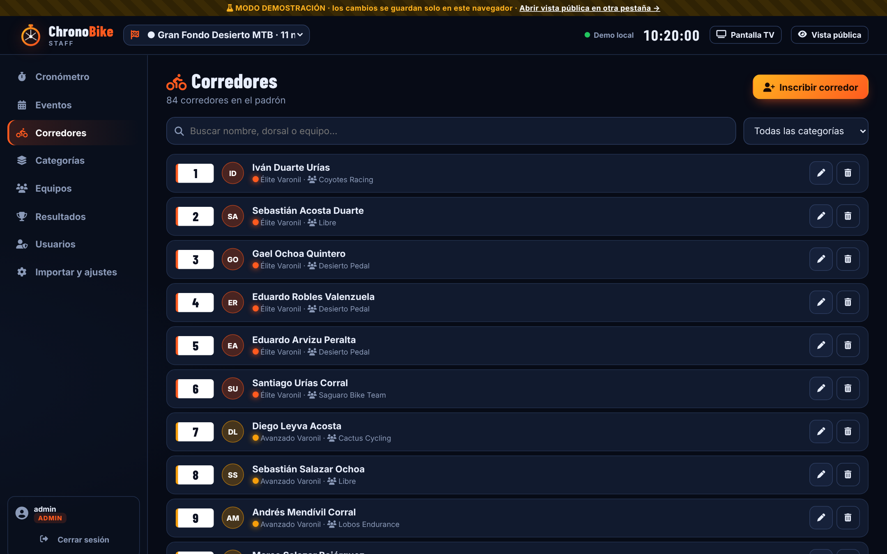

Busca, filtra por categoría, edita ✏️ o elimina 🗑️. Al eliminar un corredor **se conservan sus pasos**.

### C3. Categorías 🗂️
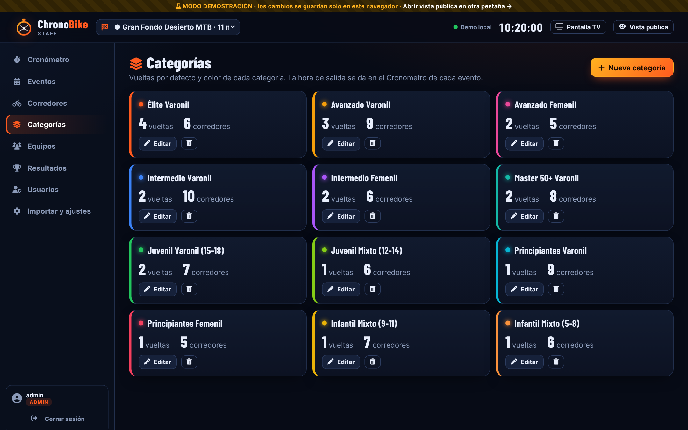

Cada categoría tiene **nombre**, **vueltas por defecto** y **color** (el color se usa en podios, tablas y dorsales).

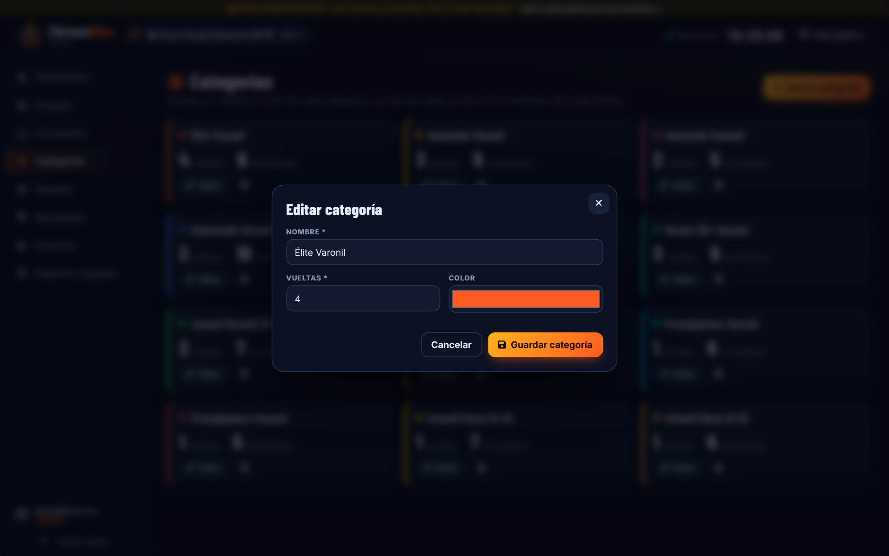

💡 La **hora de salida no va aquí**: se da en cada evento desde el Cronómetro. Así un mismo catálogo sirve para todo el serial.

### C4. Equipos 👥
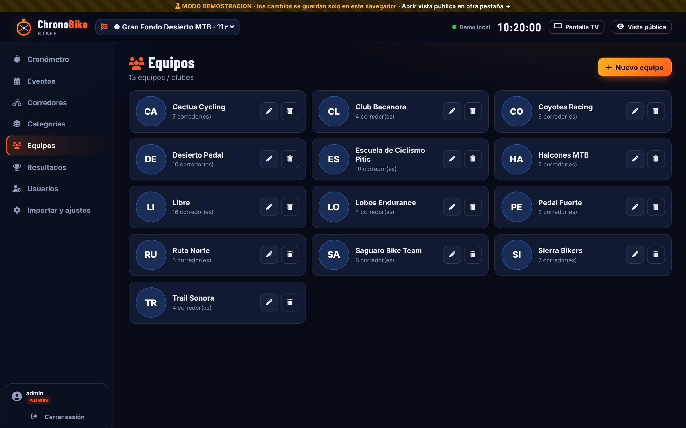

Renombra o elimina equipos. Al eliminar uno, sus corredores quedan como *Independiente*.

### C5. Resultados y exportación 🏆
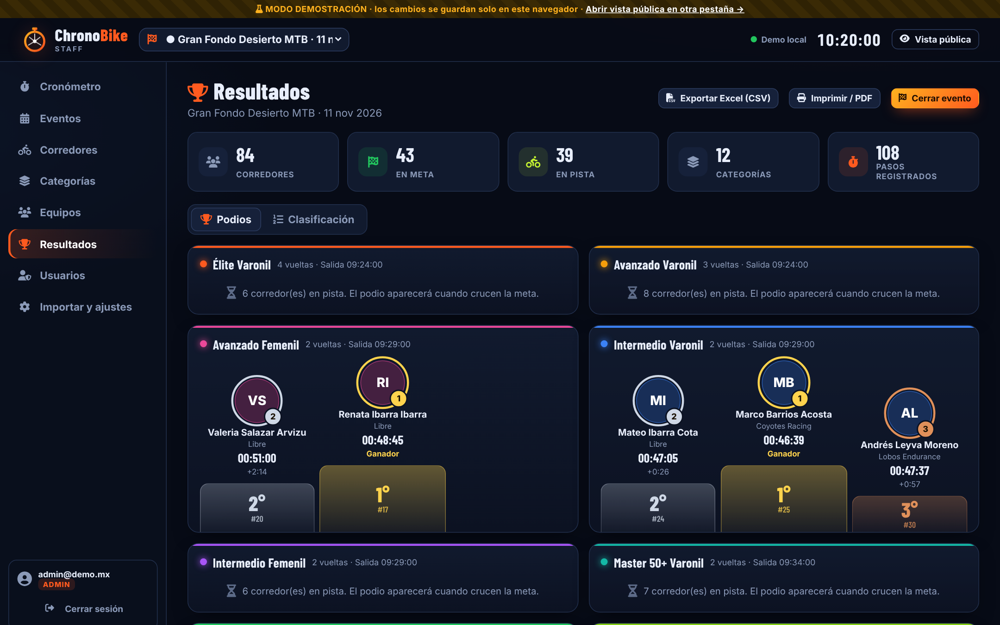

| Botón | Hace |
|---|---|
| **Exportar Excel (CSV)** | Descarga la clasificación completa: categoría, posición, dorsal, corredor, equipo, vueltas, tiempos por vuelta, tiempo oficial, diferencia y estado |
| **Imprimir / PDF** | Hoja lista para pegar en la meta o publicar |
| **Cerrar evento** | Lo marca como Finalizado |

⚠️ **Al cerrar el evento, quien se quedó a medias (en pista, sin terminar sus vueltas) pasa automáticamente a 🚩 DNF** (*Did Not Finish*, no terminó). Ya no cuenta como "En pista": es un resultado definitivo, se ordena por vueltas completadas y aparece en la tabla, el Excel y la Pantalla TV con su propia etiqueta roja. Si una categoría se cierra sin que nadie la termine, el podio muestra *"Ningún corredor completó esta categoría. Sin podio"* en vez de quedar vacío.

💡 Por eso conviene cerrar el evento **solo cuando de verdad terminó**: mientras siga abierto, los corredores que faltan por cruzar la meta se muestran como "En pista", no como DNF.

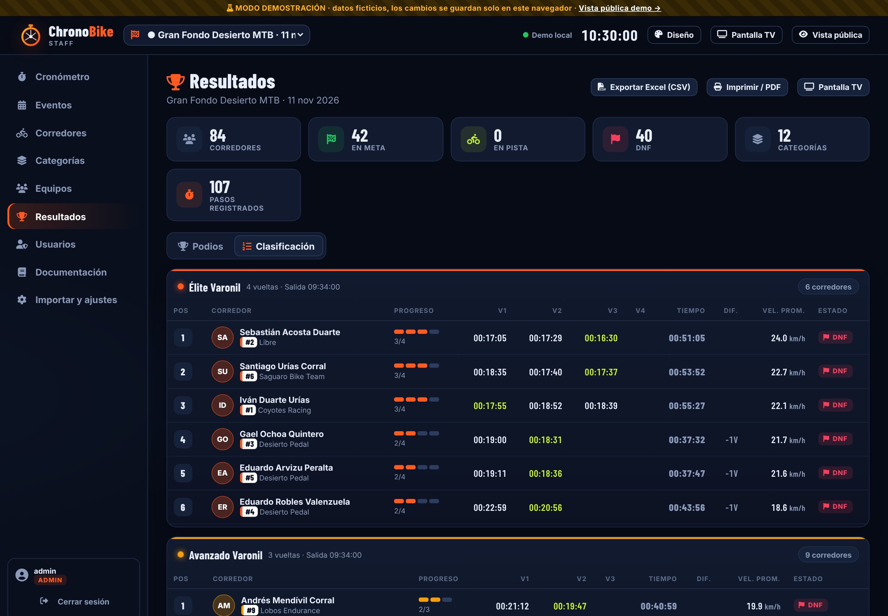

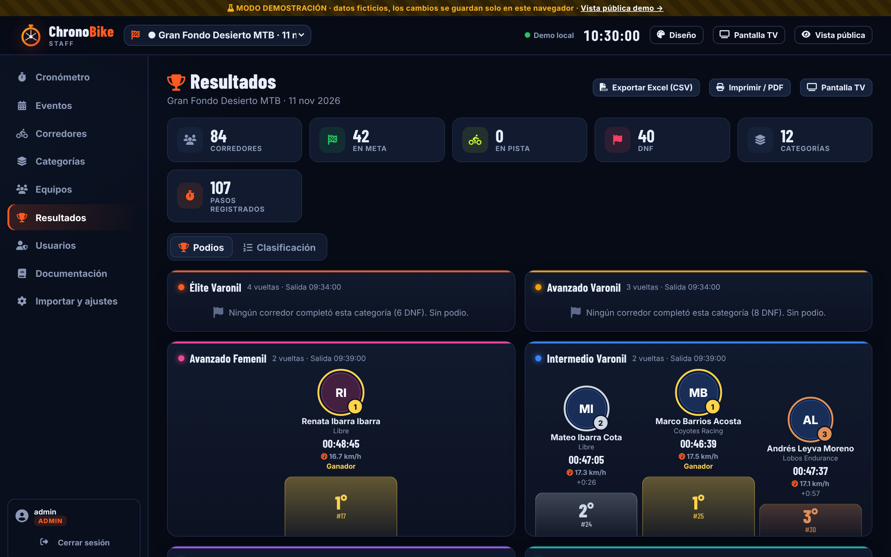

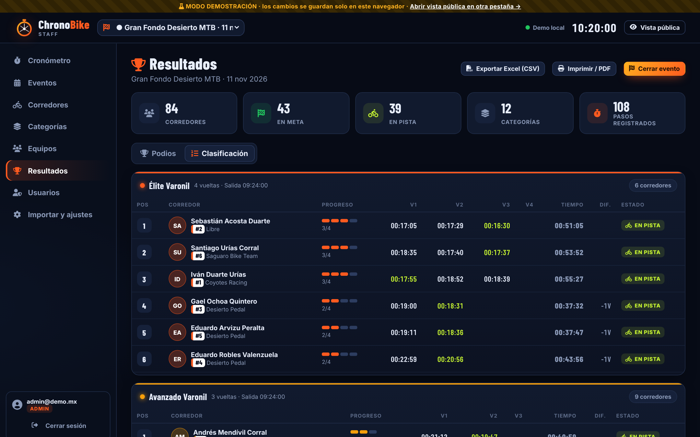

### C6. Importar el Excel actual 📥
👆 **Importar y ajustes** → arrastra tu archivo `.xlsx`.

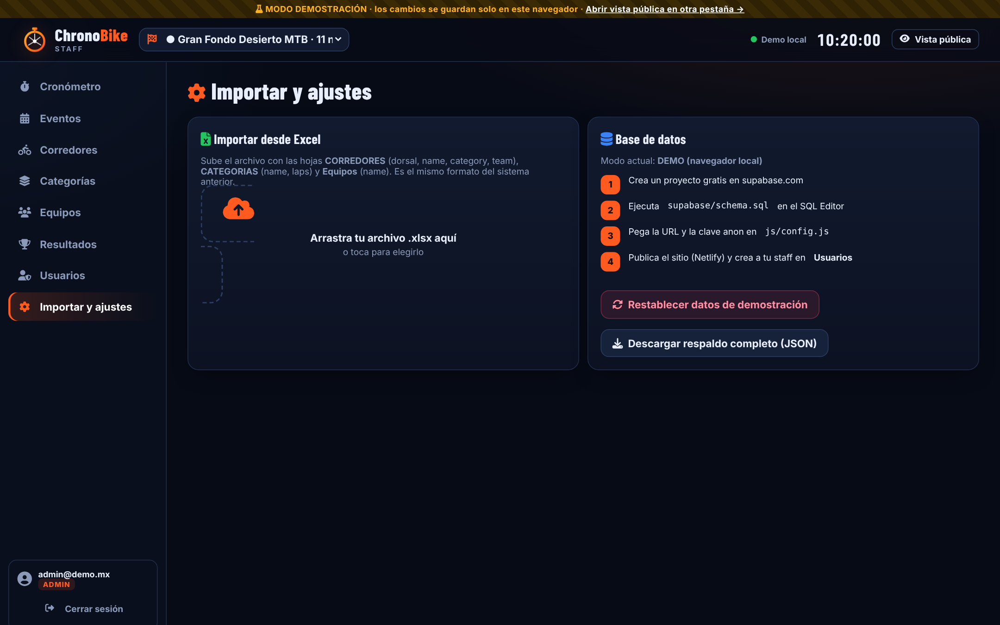

La app lee las hojas **CORREDORES** (`dorsal, name, category, team`), **CATEGORIAS** (`name, laps`) y **Equipos** (`name`), el mismo formato del sistema anterior. Muestra cuántos registros encontró. 👆 **Importar ahora**.

✅ Los dorsales existentes se actualizan y las filas sin nombre se omiten. Los datos se guardan **tal como vienen en el archivo**: si un equipo aparece escrito de varias formas (`Zorros MTB`, `ZORROS MTB`), quedan como equipos distintos. Puedes renombrarlos o eliminarlos después en **Equipos**.

### C6b. Pantalla de TV en la meta 📺
Conecta una laptop a una TV o proyector en la meta y abre **Pantalla TV** (arriba en el panel, o en **Resultados**). También puedes abrir directo `.../tv.html`.

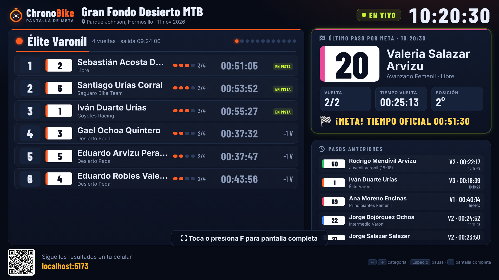

| Zona | Qué muestra |
|---|---|
| Izquierda | Clasificación de una categoría. **Cambia sola cada 12 segundos** (la barrita de color marca el tiempo). |
| Derecha, arriba | **Último paso por meta** en grande: dorsal, nombre, vuelta, tiempo de vuelta y posición. Destella con cada paso y muestra **🏁 ¡META!** al terminar. |
| Derecha, abajo | Los pasos anteriores |
| Abajo | **Código QR**: el público lo escanea y ve los resultados en su celular |

| Tecla | Hace |
|---|---|
| Clic o `F` | Pantalla completa |
| `←` `→` | Categoría anterior / siguiente |
| `Espacio` | Pausar o reanudar la rotación |

💡 No necesita iniciar sesión y se actualiza sola.
💡 Opciones en la dirección: `tv.html?s=20` (segundos por categoría) · `tv.html?n=8` (filas) · `tv.html?c=<id de categoría>` (fijar una sola categoría).

### C6c. Documentación dentro de la app 📚
👆 **Documentación** en el menú. Ahí están este manual y las guías de entrenamiento, con índice para saltar a cada sección y botón **Imprimir / PDF**.

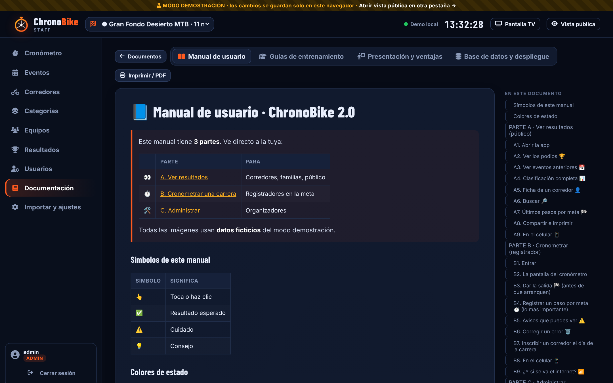

| Documento | Lo ve |
|---|---|
| Manual de usuario · Guías de entrenamiento | Todo el staff |
| Presentación y ventajas · Base de datos y despliegue | Solo administradores |

### C6d. Importar pasos (vueltas) en lote 🏁
Para cargar de golpe los pasos de otro cronómetro, de una hoja de cálculo o de una carrera que se registró en papel.

1. En el **Cronómetro**, 👆 **Importar pasos**, o ve a **Importar y ajustes**.
2. Elige el **evento destino**.
3. Pega los pasos, **una línea por paso**, con fecha/hora y dorsal. O sube un archivo Excel/CSV.
   ```
   11/1/2026 7:34:46    103
   11/1/2026 7:34:51    194
   ```
   También sirve solo la hora (`7:34:46 103`), el dorsal primero (`103;7:34:46`) o `a. m.`/`p. m.`.
4. 👆 **Revisar**. Verás cuántos pasos son nuevos, cuántos **ya estaban cargados** (no se duplican), los dorsales no inscritos y las líneas con error.
5. 👆 **Importar**.

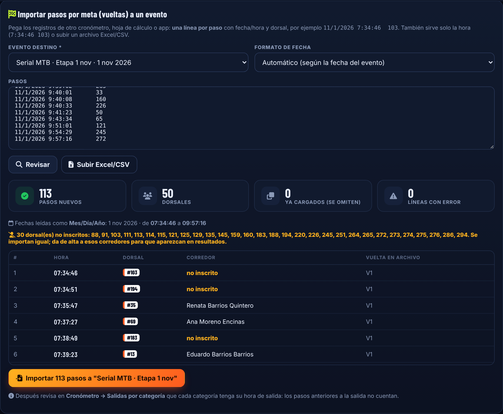

💡 **Fecha `11/1/2026`:** la app decide si es 1 de noviembre o 11 de enero comparando con la fecha del evento. Si se equivoca, cambia **Formato de fecha**.
⚠️ Después revisa en **Cronómetro → Salidas por categoría** que cada categoría tenga su hora de salida. Los pasos anteriores a la salida no cuentan.

### C6e. Modo demo para practicar 🧪
Para capacitar al staff **sin tocar los datos reales**:

| Para | Cómo |
|---|---|
| Entrar al demo | En la pantalla de acceso, 👆 **Practicar en modo demo**, o abre `tu-sitio.netlify.app/admin.html?demo=1` |
| Usuarios del demo | `admin` o `registro`, contraseña `demo` |
| Salir del demo | 👆 **Salir del demo** en la franja amarilla de arriba, o abre `.../admin.html?demo=0` |

✅ Mientras estés en demo verás la franja amarilla **MODO DEMOSTRACIÓN**, y la Pantalla TV muestra la etiqueta **DEMO**.
🎲 **Cada vez que entras al demo se generan datos nuevos al azar**: otros corredores, equipos, tiempos, sede y nombre de la carrera. La carrera **"en vivo" siempre arranca al 50 % de avance** (la mitad de los pasos por meta ya ocurrió y el resto va apareciendo solo), así que siempre hay podios, gente en pista y pasos nuevos que ver.
💡 Mientras sigas en el demo, los datos **se conservan** aunque cambies de pantalla (panel, vista pública, TV) o recargues: lo que registres no se pierde. Se generan otros nuevos al **volver a entrar** al demo, al usar **Importar y ajustes → Restablecer datos de demostración**, o si pasaron más de 3 horas (para que la carrera en vivo no quede ya terminada).
💡 Lo que hagas en el demo se guarda solo en ese navegador y **nunca** llega a la base de datos real.
⚠️ El día de la carrera, revisa que **ningún** celular ni la TV tengan la franja o la etiqueta DEMO.

### C6f. Diseño de la app 🎨
👆 **Diseño**, arriba en el panel (solo administradores; en el celular está en **Más**). Toca una opción para verla **en vivo**, y luego **Usar este diseño**. Se aplica en ese dispositivo a la vista pública, el panel y la Pantalla TV.

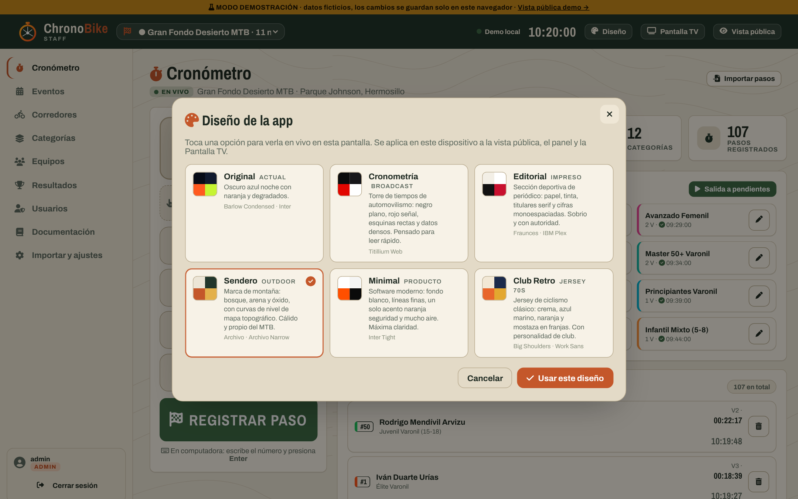

| Diseño | Idea | Vista |
|---|---|---|
| **Original** | Oscuro azul noche con naranja | — |
| **Cronometría** | Torre de tiempos de automovilismo: negro, rojo señal, esquinas rectas | 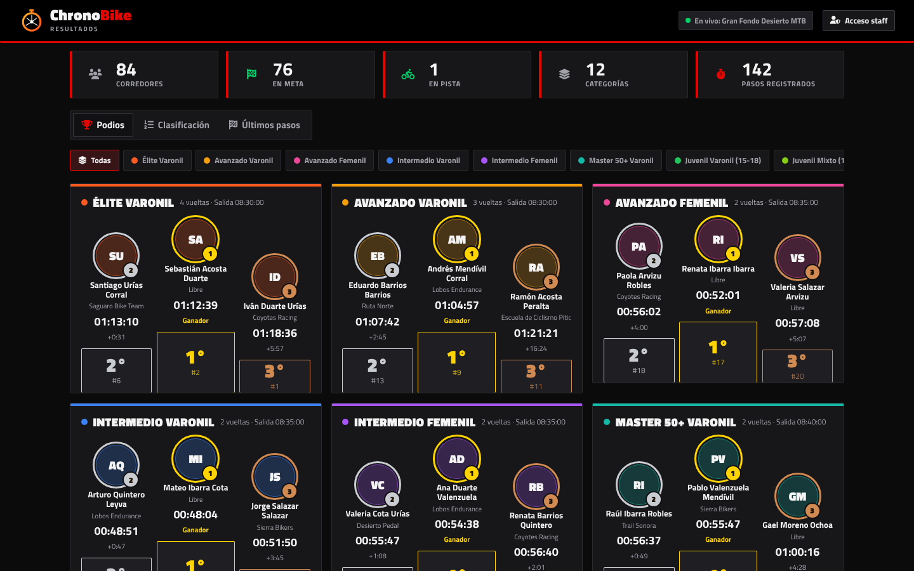 |
| **Editorial** | Periódico deportivo: papel, tinta, titulares serif | 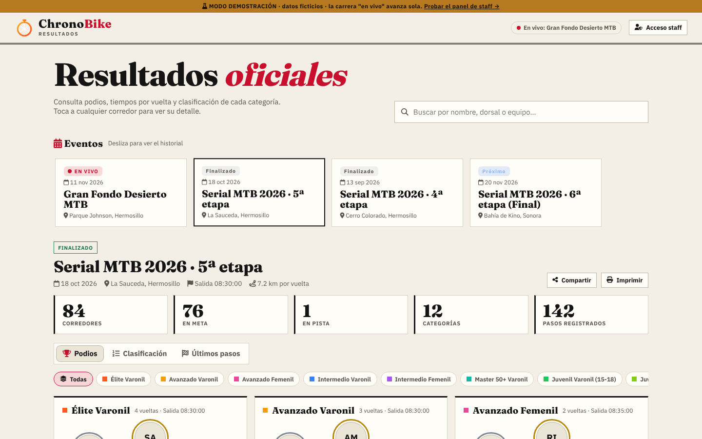 |
| **Sendero** | Marca outdoor: bosque, arena, curvas de nivel | 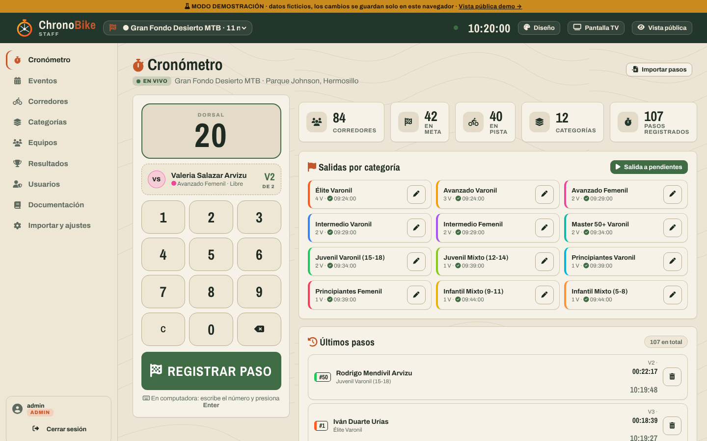 |
| **Minimal** | Software moderno: blanco, líneas finas, un acento | 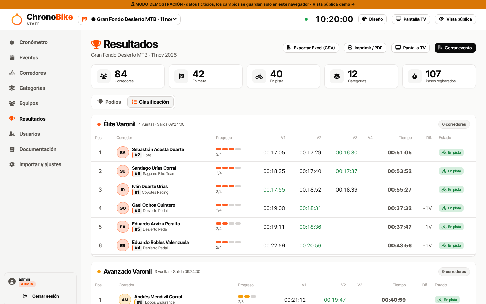 |
| **Club Retro** | Jersey de los 70: crema, azul marino, franjas | 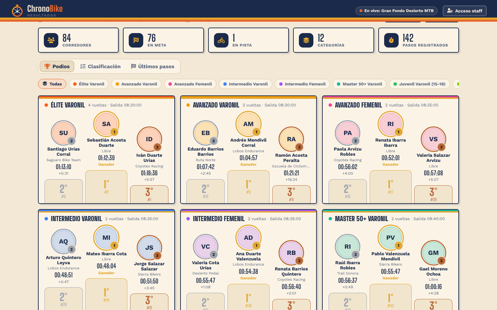 |

### C7. Respaldo 💾
👆 **Descargar respaldo completo (JSON)** después de cada evento. Guarda todo: eventos, corredores, categorías, equipos y todos los pasos.

### C8. Usuarios del staff 🔐
Las cuentas se crean **aquí mismo**, en el panel. El público no necesita cuenta.

**La primera vez**, cuando aún no hay administradores, la pantalla de entrada muestra **Configuración inicial**: eliges tu **usuario** y tu contraseña y quedas como administrador.

👆 **Usuarios** → verás a cada persona, su rol y su último acceso.

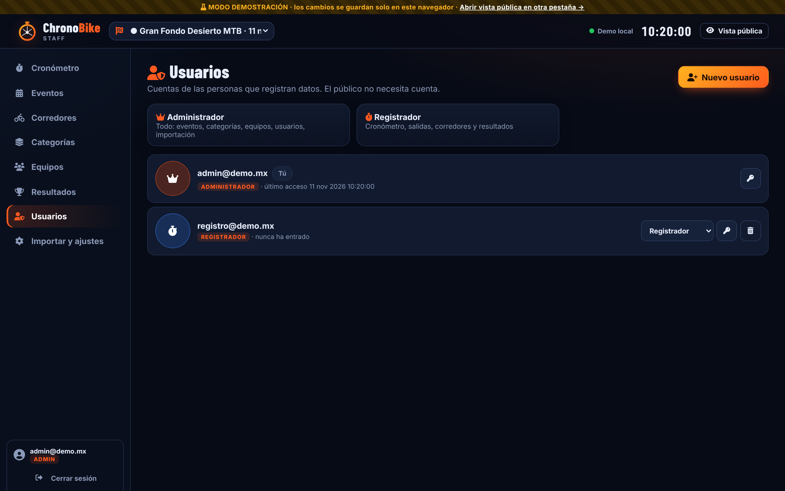

**Dar de alta a alguien:** 👆 **Nuevo usuario** → **usuario** (ej. `juan`, `meta1`; sin espacios) → la contraseña se genera sola (🎲 para otra) → elige el rol → **Crear cuenta**.

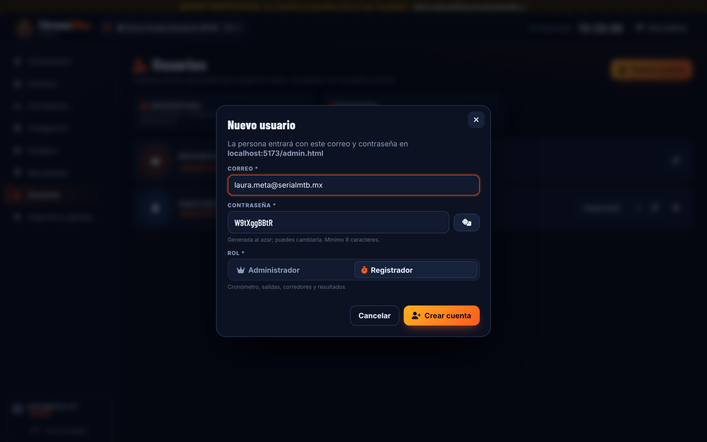

✅ Aparecen sus datos de acceso: 👆 **Copiar** o **WhatsApp** para enviárselos. ⚠️ La contraseña no se vuelve a mostrar. Si se pierde, usa 🔑 para poner otra.

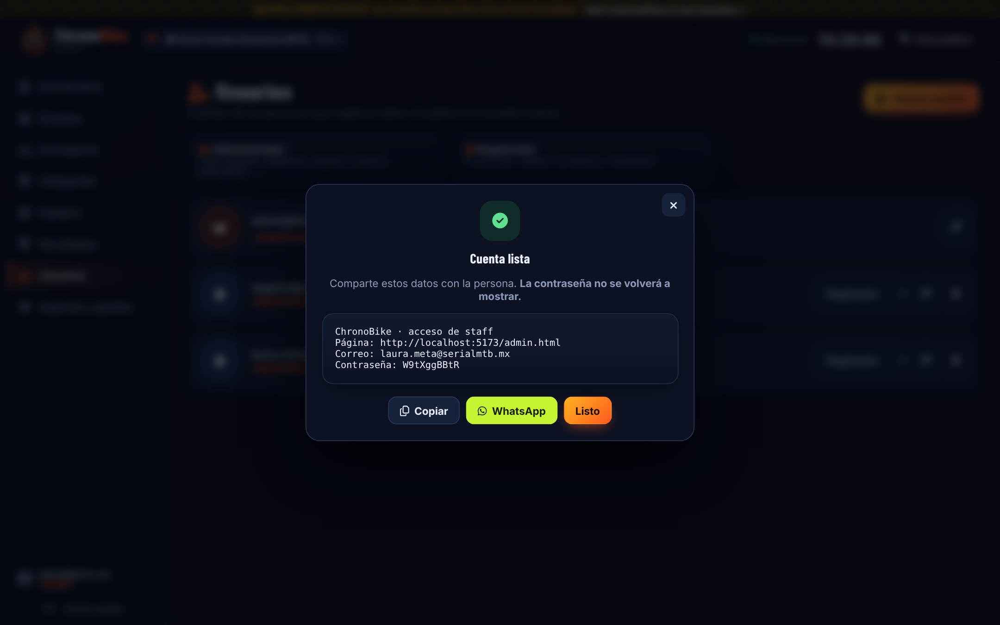

| Acción | Cómo |
|---|---|
| Cambiar el rol | Selector *Registrador / Administrador* de la persona |
| Cambiar la contraseña | 🔑 (también sirve para la tuya) |
| Quitar el acceso | 🗑️ Los pasos que registró se conservan. |

| Rol | Puede |
|---|---|
| **Administrador** | Todo: eventos, categorías, equipos, usuarios e importación |
| **Registrador** | Cronómetro (salidas y pasos), Corredores (alta y edición), Resultados |

💡 No puedes cambiar tu propio rol ni eliminar tu propia cuenta, así el sistema nunca se queda sin administrador.

---

## ❓ Preguntas frecuentes

| Pregunta | Respuesta |
|---|---|
| ¿Cómo se calcula el tiempo oficial? | Hora de su última vuelta requerida menos la hora de salida de su categoría. |
| ¿Por qué un corredor no aparece en el podio? | Le faltan vueltas (está EN PISTA) o su categoría no tiene salida. |
| Registré pasos antes de dar la salida, ¿qué pasa? | Esos pasos se ignoran. Si la salida real fue antes, corrígela con ✏️ y los tiempos se recalculan. |
| ¿Pueden registrar 2 personas a la vez? | Sí, en celulares distintos y con el mismo evento activo. |
| ¿Se puede usar en una pantalla grande en la meta? | Sí: abre la vista pública en una laptop conectada a la TV. Se actualiza sola. |
| ¿Qué tan exacta es la hora? | Usa el reloj del teléfono, con milisegundos. 💡 Activa "hora automática" en todos los celulares del staff. |
