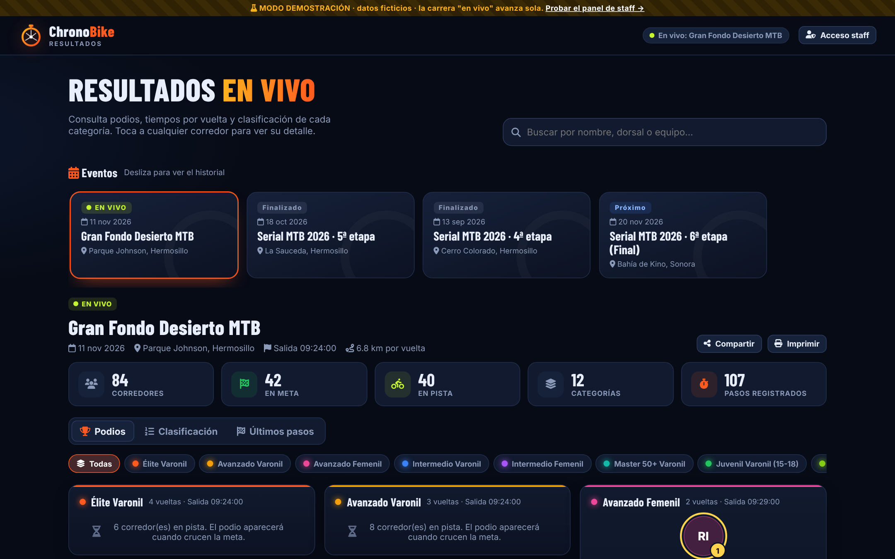
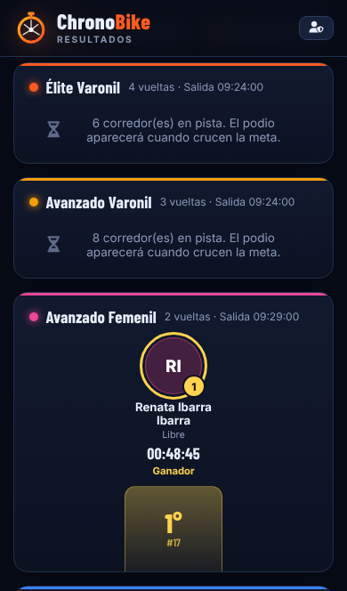
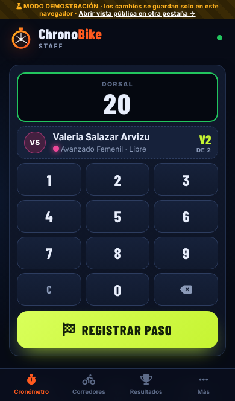
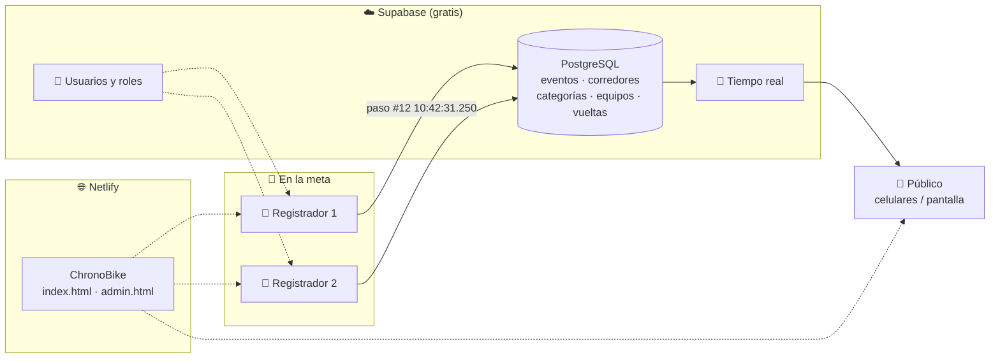
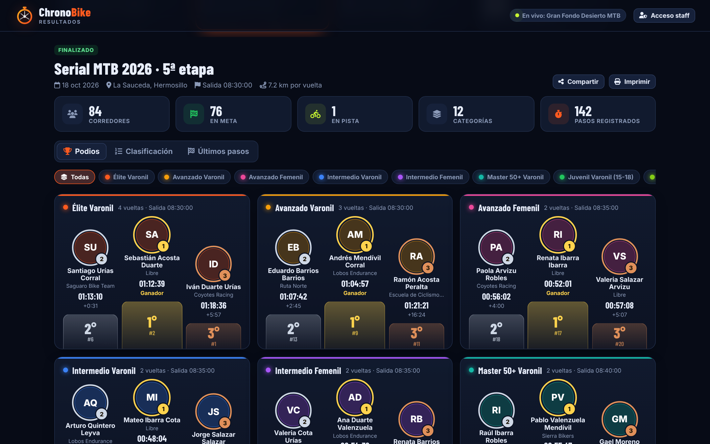
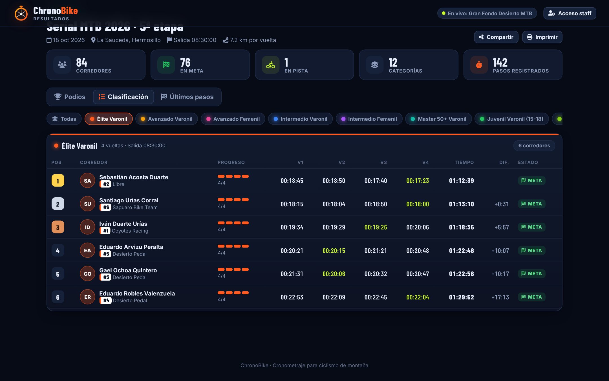
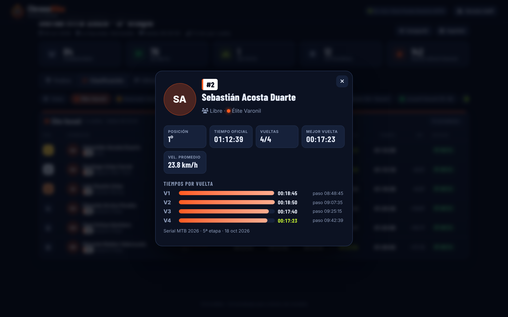
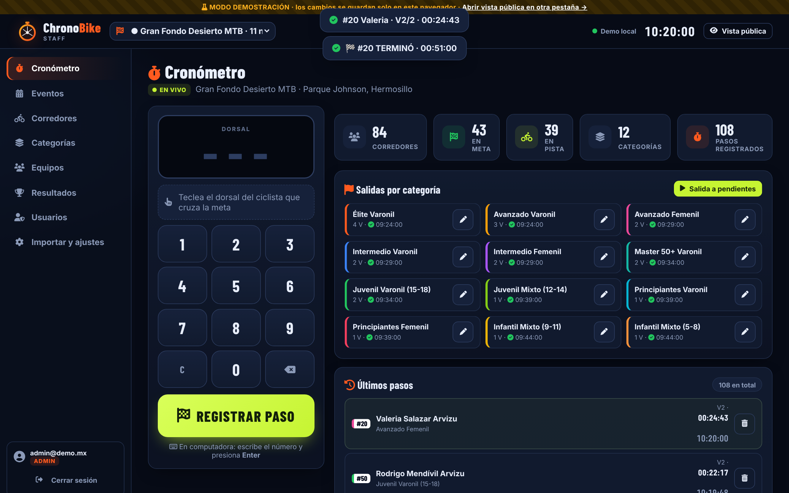

# ChronoBike 2.0
### Cronometraje de circuitos y resultados en vivo

---

## 1. El problema

En las carreras locales de MTB, el cronometraje suele hacerse con libreta y cronómetro, con hojas de Excel, o con sistemas de chip que cuestan miles de pesos por evento. Eso trae problemas:

- Los resultados tardan horas en publicarse, a veces días, y los corredores preguntan sin parar "¿en qué lugar quedé?".
- Al copiar datos a mano se cuelan errores: dorsales repetidos, equipos escritos de 5 formas, tiempos mal restados.
- Si se cae el internet en la sierra, se pierde información.
- No queda un historial ordenado de los eventos anteriores.

## 2. Diagnóstico del sistema anterior (cronobike.netlify.app)

Analizamos la app actual y el archivo `chronobike.xlsx`. Funciona como una sola página HTML que guarda en Google Sheets mediante Apps Script. Esto encontramos:

| # | Hallazgo | Impacto | Cómo lo resuelve ChronoBike 2.0 |
|---|---|---|---|
| 1 | La **hora de salida vive en la categoría**, sin fecha, y es la misma para todos los eventos. La mayoría tenía `20:00` y las vueltas se registraron a las `10:40`. | **Tiempos falsos**: en la hoja RESULTADOS aparece `V1: 23:40:32` en una carrera de minutos. | Tabla nueva `event_categories`: salida **por evento y por categoría**, con fecha y hora exactas, y un botón **"Dar salida"**. |
| 2 | El ranking ordena por **número de vueltas** y luego por **hora de reloj** del último paso. | Quien da una vuelta de más queda arriba. Las categorías con salidas distintas se comparan mal. | Se ordena por **tiempo oficial** (último paso válido menos salida), **dentro de cada categoría**. Las vueltas extra se ignoran y se marcan. |
| 3 | La clasificación es una sola tabla que mezcla todas las categorías. | Un "podio" que no tiene sentido deportivo. | **Podio y tabla por categoría**, con diferencia contra el líder. |
| 4 | **No hay usuarios.** La URL de la base de datos va dentro del código público. | Cualquiera puede borrar o alterar resultados. | Login de staff (Supabase Auth) y **seguridad por filas**: el público solo lee. |
| 5 | Los pasos solo guardan la hora `HH:MM:SS`. | Pierde la fecha y las décimas, y falla al pasar la medianoche. | Marca de tiempo completa con milisegundos. |
| 6 | No hay control de dobles toques. | Pasos duplicados que alteran los tiempos. | Aviso si el mismo dorsal se registra en menos de 30 s, y aviso si ya terminó. |
| 7 | Hay 95 "equipos", muchos duplicados (`Zorros MTB`, `ZORROS MTB`, `Zorros mtb`). | Estadísticas por equipo inservibles. | La importación respeta los datos tal como vienen. Desde **Equipos** se renombran o eliminan los duplicados. |
| 8 | Hay filas de corredores sin nombre ni categoría (dorsal 18, 23, 32…). | Huecos en los resultados. | Nombre y categoría obligatorios. La importación omite filas vacías y avisa. |
| 9 | Si falla el internet, los datos quedan solo en el teléfono, sin reintento claro. | Riesgo de perder vueltas. | **Cola offline**: cada paso se guarda en el teléfono y se reenvía solo al volver la señal. |

## 3. La solución

**Una sola app web, dos experiencias:**

<table><tr>
<td width="50%"><h4>👀 Público</h4> Podios, clasificación, tiempos por vuelta, buscador y eventos anteriores. Sin cuenta y sin instalar nada. Se puede compartir por WhatsApp.</td>
<td width="50%"><h4>🛡️ Staff</h4> Teclado gigante para registrar pasos, salidas por categoría, alta de corredores con foto, eventos, equipos, importación de Excel y exportación de resultados.</td>
</tr></table>

### Funciones clave

- ⚡ **Registro en un toque.** Tecleas el dorsal y ves al instante quién es, su categoría y qué vuelta lleva. Luego presionas REGISTRAR. Hay vibración, sonido y confirmación visual.
- 🏁 **Salidas por categoría** con un botón. Las salidas escalonadas se cronometran solas.
- 🏆 **Podios automáticos** (oro, plata, bronce) por categoría, con foto.
- 📊 **Tabla en vivo** con progreso de vueltas, tiempo de cada vuelta, mejor vuelta resaltada, diferencia con el líder y estado (En pista / Meta / Sin paso).
- 👤 **Ficha del corredor** con gráfica de vueltas y velocidad promedio.
- 📺 **Pantalla de TV para la meta**: clasificación que rota por categoría, último paso en grande y QR para el público.
- 📡 **Tiempo real**: lo que registra el staff aparece en los celulares del público en 1 o 2 segundos.
- 📶 **A prueba de mala señal**: cola offline con reintento automático.
- 📥 **Migración inmediata**: importa el Excel actual (`CORREDORES`, `CATEGORIAS`, `Equipos`).
- 📤 **Exporta** a Excel (CSV) y a PDF (imprimir).
- 🔐 **Dos roles**: *Administrador* (todo) y *Registrador* (cronómetro, corredores, resultados). Las cuentas se crean **desde la app** y los datos de acceso se envían por WhatsApp.
- 🧪 **Modo demostración** con datos ficticios para capacitar sin riesgo.

## 4. Ventajas frente a otras opciones

| Criterio | Libreta + Excel | App anterior | Sistemas de chip RFID | Apps genéricas de cronómetro | **ChronoBike 2.0** |
|---|:-:|:-:|:-:|:-:|:-:|
| Costo por evento | Bajo | Gratis | 💲💲💲 (renta de tapetes y chips) | Suscripción | **Gratis** (plan gratuito de Supabase y Netlify) |
| Resultados en vivo para el público | ❌ | Parcial | ✅ | Rara vez | ✅ |
| Salidas escalonadas por categoría | Manual | ❌ (con error) | ✅ | ❌ | ✅ |
| Podio por categoría | Manual | ❌ | ✅ | ❌ | ✅ |
| Historial de eventos | Archivos sueltos | Parcial | Según proveedor | ❌ | ✅ |
| Seguridad y usuarios | ❌ | ❌ | ✅ | ✅ | ✅ |
| Funciona sin internet | ✅ | Parcial | ✅ | Parcial | ✅ (cola offline) |
| Hardware especial | No | No | Sí: tapetes, antenas, chips | No | **No, solo un celular** |
| Personalizable a tu serial | Sí | Difícil | No | No | ✅ (código propio) |
| Curva de aprendizaje | Baja | Media | Alta (técnico) | Media | **Muy baja** |

> **Dónde no compite:** en eventos de más de 500 corredores con llegadas masivas, un sistema de chip sigue siendo superior. ChronoBike está pensado para seriales locales y regionales (de 50 a 400 corredores), donde 1 o 2 registradores con celular bastan. En el futuro se puede conectar un lector de chip (ver Hoja de ruta).

## 5. Cómo funciona (arquitectura)

- **Frontend:** HTML, CSS y JavaScript sin compilación. Se publica arrastrando la carpeta a Netlify.
- **Backend:** Supabase (PostgreSQL administrado, autenticación y tiempo real), con políticas de seguridad en la propia base de datos.
- **Cálculo de tiempos:** en el navegador (`js/results.js`), con pruebas automáticas.

## 6. Costos estimados

| Concepto | Costo |
|---|---|
| Hosting web (Netlify, plan gratuito) | $0 |
| Base de datos, usuarios y tiempo real (Supabase, plan gratuito: 500 MB, 50 000 usuarios activos) | $0 |
| Dominio propio opcional (ej. `resultados.miserial.mx`) | ~$300 MXN/año |
| Hardware | Los celulares del staff |

> Referencia: un evento de 250 corredores × 4 vueltas genera unos 1 000 registros, menos de 1 MB. El plan gratuito alcanza para cientos de eventos.
> Nota: Supabase pausa los proyectos gratuitos sin actividad en 7 días. Basta con entrar al panel o abrir la app antes del evento. Para operación continua existe el plan Pro (~25 USD/mes).

## 7. Hoja de ruta sugerida

1. **Fase 1 (lista):** app pública + staff, importación de Excel, demo, documentación.
2. **Fase 2:** inscripción en línea de corredores. Fotos en Supabase Storage.
3. **Fase 3:** campeonato del serial (puntos acumulados por etapa), estados DNF/DSQ, penalizaciones.
4. **Fase 4:** integración con lector RFID o código QR en el número. Notificaciones por WhatsApp.

## 8. Demo con datos ficticios

Todas las capturas de este documento y del manual usan **datos ficticios** generados por la app: 4 eventos (2 finalizados, 1 en vivo, 1 próximo), 12 categorías, 13 equipos y 84 corredores.

| Podios de un evento anterior | Clasificación con tiempos por vuelta |
|---|---|
|  |  |
| **Ficha del corredor** | **Cronómetro del staff** |
|  |  |
