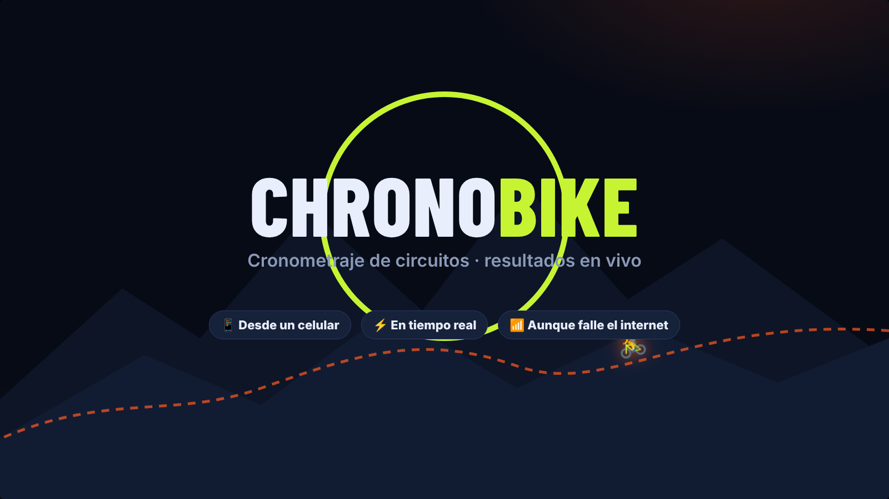
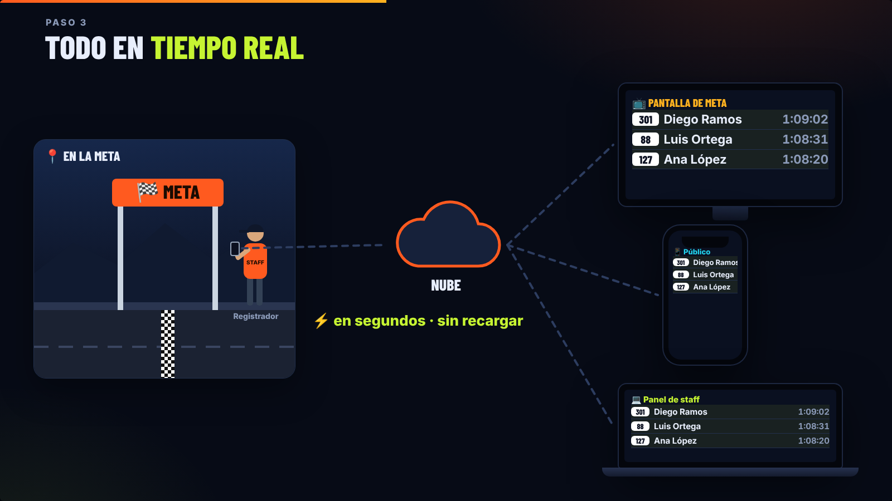
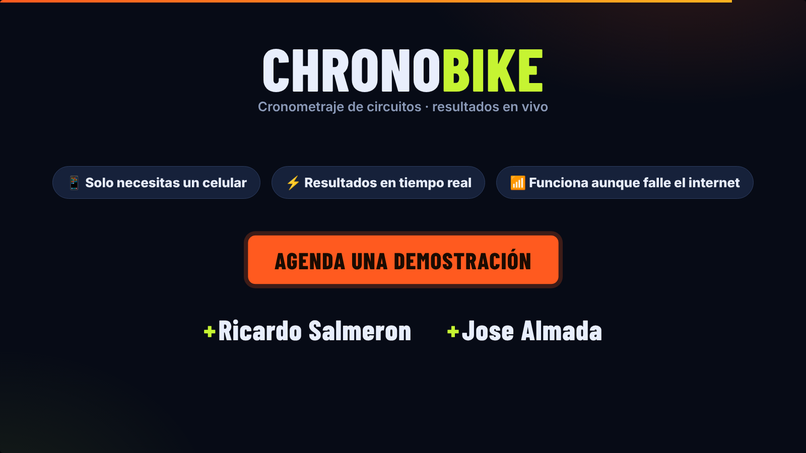

# 🎬 Presentación animada para clientes

> Animación con **voz en off y subtítulos** para mostrar ChronoBike a posibles compradores: organizadores de carreras, seriales y clubes. Se abre en una pestaña nueva y se puede proyectar en pantalla completa.

| Versión | Duración | Para qué |
|---|---|---|
| ▶ **[Versión larga](../docs/presentacion-animada.html?v=larga)** | ≈ 2 min · 10 escenas | Reuniones, presentaciones, stands |
| ▶ **[Versión corta](../docs/presentacion-animada.html?v=corta)** | ≈ 30 s · 5 escenas | Redes sociales, WhatsApp, inicio de una reunión |

---

## Cómo usarla

1. Abre la versión que quieras y toca **▶ Ver presentación** (el navegador pide un toque para permitir el sonido).
2. Usa **⛶** o la tecla `F` para pantalla completa.
3. Controles: **espacio** pausa o reanuda, **← / →** cambian de escena, `M` silencia, `S` muestra u oculta los subtítulos, **🔁** la repite sin parar (modo stand).
4. Los puntos de la barra inferior saltan directo a cualquier escena.

> **Voz:** usa la narración grabada cuando está disponible. Si no, usa la voz en español del navegador. Si el equipo no tiene ninguna, la presentación sigue con subtítulos. El tipo de voz en uso aparece en la esquina de la barra.

## Escenas · versión larga

| # | Escena | Qué se ve |
|---|---|---|
| 1 | Apertura | Ciclista en un circuito de montaña, logo y las tres ideas clave |
| 2 | El problema | Libreta, Excel con errores, "+3 h" y las preguntas de los corredores |
| 3 | Prepara tu evento | Alta del evento, importación de 256 corredores desde Excel y categorías con colores |
| 4 | Cronometra desde la meta | Salidas por categoría; en la meta, una ciclista cruza la línea y la persona del staff la registra; dorsal tecleado, quién es y qué vuelta lleva, registro con sonido y vibración, aviso de duplicado |
| 5 | Tiempo real | Los ciclistas cruzan la meta y cada paso viaja a la nube y aparece en la pantalla de meta, el celular del público y el panel del staff |
| 6 | Sin internet | Los pasos se guardan en cola y se envían solos al volver la señal |
| 7 | Resultados automáticos | Podio, vueltas, mejor vuelta, velocidad promedio, DNF y exportación a Excel/PDF |
| 8 | Para el público | Código QR en la pantalla y resultados en el celular, sin descargar nada |
| 9 | Historial del serial | Etapas anteriores con sus podios y búsqueda de un corredor en todas ellas |
| 10 | Cierre | Beneficios, "Agenda una demostración" y el equipo: **+Ricardo Salmeron · +Jose Almada** |

## Guion de la voz en off

**Versión larga**

1. Esto es ChronoBike: cronometraje de circuitos y resultados en vivo, desde un celular.
2. En muchas carreras todavía se cronometra con libreta y Excel. Los resultados tardan horas, se cuelan errores al pasar los datos, y los corredores no dejan de preguntar en qué lugar quedaron.
3. Con ChronoBike, preparas el evento en minutos. Creas la carrera, importas a tus corredores desde Excel, y el sistema arma las categorías con sus vueltas y colores.
4. El día de la carrera, das la salida de cada categoría con un toque. En la meta, el registrador teclea el dorsal, ve al instante quién es y qué vuelta lleva, y registra el paso. Un sonido fuerte y la vibración lo confirman, y la app avisa si un paso parece duplicado.
5. Cada paso llega en segundos a la nube y se reparte en tiempo real: a la pantalla de la meta, al celular del público y al panel del staff. Sin recargar, sin esperar.
6. ¿Y si se cae el internet? La app sigue registrando, guarda los pasos en el celular y los envía solos cuando vuelve la señal. Ningún paso se pierde.
7. Los resultados se calculan solos: podio por categoría, tiempo de cada vuelta, la mejor vuelta, la velocidad promedio, y quien no terminó queda como DNF al cerrar el evento. Todo se exporta a Excel o PDF con un clic.
8. El público escanea el código QR de la pantalla y consulta los resultados en su celular, sin descargar nada.
9. Y cada evento queda guardado: tu serial completo, con podios y tiempos de todas las etapas, para consultarlo cuando quieras.
10. ChronoBike: solo necesitas un celular, resultados en tiempo real, y funciona aunque falle el internet. Agenda una demostración con nuestro equipo.

**Versión corta**

1. ChronoBike: cronometraje y resultados en vivo, desde un celular.
2. En la meta, tecleas el dorsal y registras el paso con un toque.
3. Los resultados llegan en segundos a la pantalla y al celular del público.
4. Podios, tiempos por vuelta y métricas, calculados solos.
5. Funciona aunque falle el internet. Agenda tu demostración.

> Los nombres, tiempos y velocidades que aparecen en la animación son **datos ficticios** de demostración.
