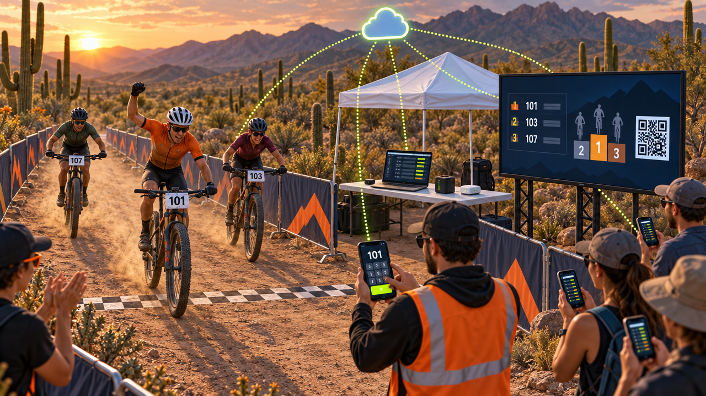
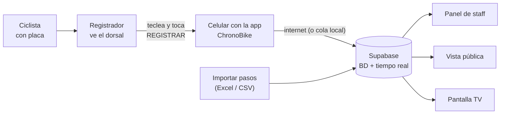
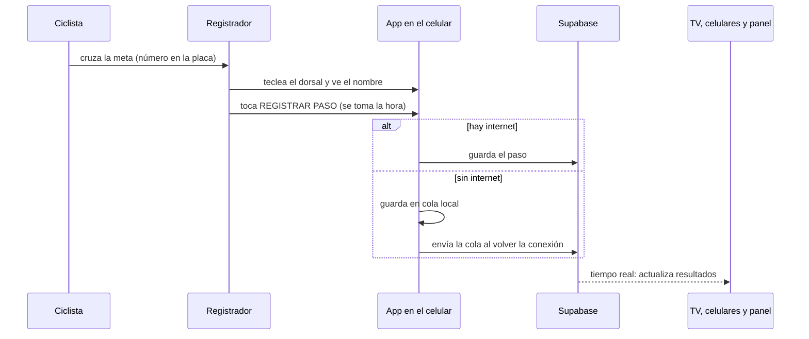
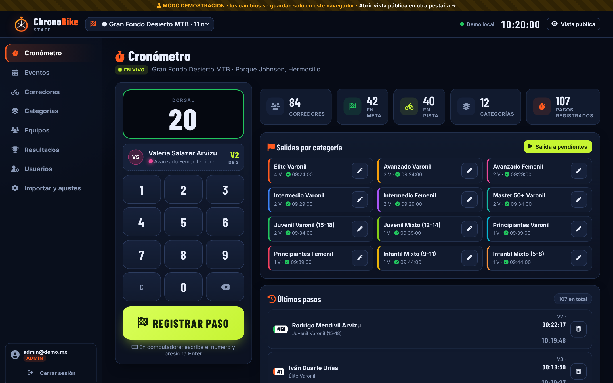
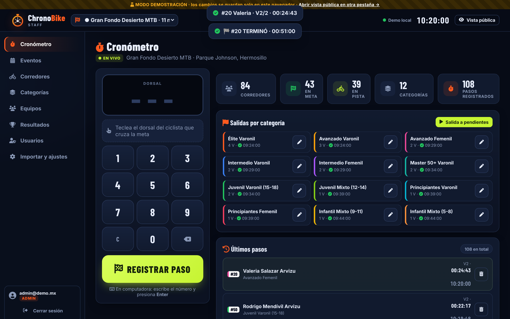

# 🧭 Sistema actual · esquema y simulación

> **Estado: funciona hoy.** Una persona en la meta registra cada paso por dorsal desde el celular, y los resultados llegan solos a la TV, al público y al panel del staff.

▶ **[Abrir la simulación interactiva](../docs/animacion-actual.html)**: el registrador teclea, la app registra, el dato viaja a la nube y a las pantallas. Incluye el **retraso de captura** real, la **caída de internet** (cola en el celular), el esquema de bloques, el plano de la meta y capturas reales.

---

## 1. Esquema del sistema

Todo el software de este esquema **ya existe y funciona**. El paso humano es el del registrador: de su atención y rapidez depende la precisión del tiempo.

## 2. Qué pasa con cada paso por meta

La **hora del paso es la del momento en que se toca REGISTRAR**, no la del cruce. Por eso hay un pequeño retraso humano (en la simulación se ve entre 1 y 3 segundos, y crece en los pelotones).

## 3. Cómo se registra un paso, en la práctica

1. **Mira** el número de la placa del ciclista que cruza.
2. **Teclea** el dorsal. La app muestra quién es, su categoría y qué vuelta le toca (verde = inscrito, amarillo = no inscrito).
3. **Toca REGISTRAR PASO** (o `Enter` en computadora). Suena un bip fuerte, el celular vibra y aparece el aviso.
4. Si completó todas sus vueltas, aparece **🏁 TERMINÓ** con su tiempo oficial.

## 4. Qué se necesita en la meta

| Equipo | Para qué |
|---|---|
| Celular del registrador con la app y batería externa | Registrar los pasos |
| Internet (datos móviles o hotspot) | Subir los pasos; si falla, la app guarda en cola |
| Laptop del admin | Vigilar resultados y corregir |
| Pantalla TV o proyector con la Pantalla de meta | Resultados en vivo y código QR para el público |
| Celular de respaldo | Si falla el principal |
| **2º registrador** si hay más de ≈150 corredores | Que los pelotones no se atoren |

## 5. Buenas prácticas

- **Teclea → mira el nombre → registra.**
- En un pelotón, registra **uno por uno sin pausa**, en el orden de llegada.
- Antes de la carrera, da la **salida** de cada categoría y revisa que todas tengan su hora.
- Resuelve en el momento los avisos de duplicado o de dorsal no inscrito.
- Al terminar: revisa el panel, **cierra el evento** (los que se quedaron a medias pasan a DNF) y exporta.

## 6. Límites que conviene conocer

- La precisión es de **≈1 segundo** y depende de la persona.
- Con muchos ciclistas llegando juntos, **los últimos del pelotón se registran con más retraso**.
- Es un solo punto de lectura humano: conviene un respaldo.
