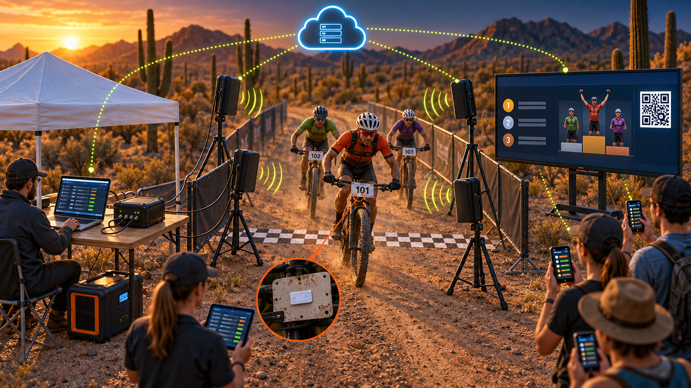
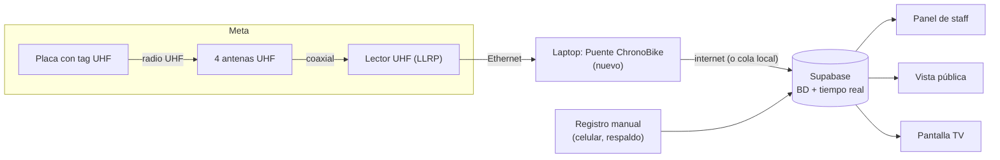
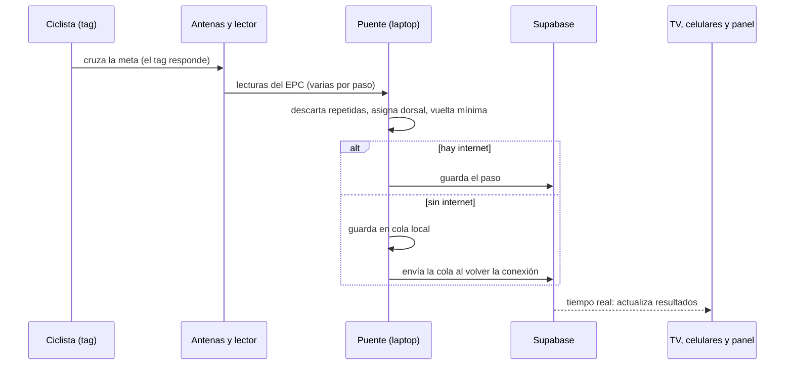

# 📡 ChronoBike con chip · esquema, referencias y prompts

> **Estado: propuesta.** El registro por chip **todavía no está construido**. Hoy funciona el registro manual por dorsal, que seguiría como respaldo. Este documento muestra cómo quedaría el sistema.



▶ **[Abrir la animación interactiva](../docs/animacion-chip.html)**: flujo completo, simulación de caída de internet, esquema de bloques y plano de la meta.

---

## 1. Esquema del sistema



| Parte | Estado |
|---|---|
| Supabase, panel de staff, vista pública, pantalla TV, registro manual | ✅ **Ya funciona hoy** |
| Puente de lectura (laptop), tabla de tags, pantalla "Chips" | 🟠 **Por construir** |
| Tags, antenas, lector, cables, energía | 🔘 **Hardware a comprar** |

## 2. Qué pasa con cada paso por meta



Un mismo paso genera varias lecturas del tag; el puente deja **una sola** por paso. Si se cae el internet, el chip sigue leyendo y **no se pierde ningún paso**.

## 3. Plano de la meta (vista superior)

La animación incluye el plano completo (antenas A1 a A4, carpa, TV, registrador manual). Resumen de medidas **iniciales, a probar en campo**:

| Elemento | Valor inicial |
|---|---|
| Ancho de la meta | ≈ 3.6 m |
| Antenas | 4: 2 por lado, ≈ 2 m entre las dos de un mismo lado |
| Altura de antenas | 1.2 a 1.5 m, inclinadas ≈ 15° hacia el carril |
| Cables | Fuera del carril; los que cruzan la pista, con protector tipo rampa |
| Equipo | Carpa con mesa: lector, laptop con el puente y energía portátil |
| Público | TV con resultados y código QR hacia el público |
| Respaldo | Una persona con el registro manual por dorsal |

## 4. El tag en la placa

- **XC y circuitos:** tag UHF pasivo pegado al **reverso de la placa**, centrado.
- Que **no toque ni quede cubierto** por el manubrio o los cables de freno: pierde alcance.
- **Enduro y descenso:** normalmente se usa un chip activo (con batería) en la horquilla.
- El metal de la bici y el lodo reflejan la señal: **probar con bicis reales antes del evento**.

## 5. Referencias visuales

Fotos y guías reales de montajes parecidos (cada sitio muestra su propio equipo):

- [Atlas RFID: cronometraje con RFID de maratones a bicicleta de montaña](https://www.atlasrfidstore.com/rfid-insider/from-marathons-to-mountain-bikes-to-motocross-timing-your-race-with-rfid)
- [The Timing Team (NZ): cronometraje de MTB con tags en placa](https://thetimingteam.co.nz/mountain-biking/)
- [Webscorer: montaje recomendado de hardware RFID](https://www.webscorer.com/blog/post/2020/01/16/RECOMMENDED-RFID-TIMING-HARDWARE-SETUP)
- [Atlas RFID: serie "Race Timing"](https://www.atlasrfidstore.com/rfid-resources/race-timing-series-part-one/)
- [RACE RESULT: sistema pasivo con antenas](https://raceresult.com/en//solutions/trackdays)

Para buscar más imágenes: *"RFID race timing finish line antenna tripod"*, *"UHF ground mat antenna race timing"*, *"MTB number plate RFID tag"*.

## 6. Prompts para generar la imagen con Gemini

La imagen de arriba se generó con otra herramienta. Si quieres otra versión con Gemini (modelos de imagen "Nano Banana" o Imagen), estos prompts funcionan bien. Pídele formato **16:9**.

### Prompt A · Escena realista del sistema completo

```
Ilustración 3D isométrica en formato 16:9 de un sistema completo de cronometraje con chips RFID para una carrera de bicicleta de montaña, en la meta, en el desierto de Sonora al atardecer (hora dorada), con cactus y montañas al fondo.

Al centro, un pasillo de meta de tierra de 3.6 metros de ancho con una línea de meta de cuadros blancos y negros en el piso. A cada lado del pasillo, dos antenas UHF negras en tripiés (cuatro en total) inclinadas hacia los ciclistas, con cables coaxiales delgados que van a una mesa bajo una carpa blanca. En la mesa hay un lector RFID negro compacto, una laptop con un tablero de resultados en vivo y una estación de energía portátil.

Tres ciclistas de montaña con placas de número cruzan la meta; en el reverso de una placa se ve un pequeño tag RFID blanco (en un círculo de zoom). Ondas de radio sutiles entre las antenas y las placas.

A la derecha, una pantalla LED grande sobre pedestal muestra una tabla de posiciones con un podio y un código QR. Espectadores con celulares que muestran los resultados. Arriba, un ícono de nube conectado con líneas punteadas luminosas a la laptop, la pantalla, los celulares y una tablet del staff.

Estilo infografía tecnológica moderna, tonos azul marino profundo con acentos naranja (#ff5a1f) y verde limón (#c6f432), sombras suaves, mucho detalle, nítido. Sin texto, sin letras, sin logotipos, sin marcas de agua.
```

### Prompt B · Esquema técnico con etiquetas

```
Infografía técnica isométrica 16:9 sobre fondo azul marino oscuro que muestra el flujo de un sistema de cronometraje con chips en una carrera de ciclismo, de izquierda a derecha en cinco pasos numerados: (1) ciclista con placa y tag UHF, (2) cuatro antenas en tripiés y un lector, (3) laptop con el "Puente ChronoBike", (4) una nube con base de datos, (5) tres pantallas: una TV con resultados, un celular del público y una tablet de staff. Flechas luminosas naranjas entre los pasos. Etiquetas cortas en español, en letra grande y legible: "1 Tag en la placa", "2 Antenas y lector", "3 Puente", "4 Nube", "5 Pantallas". Estilo limpio y minimalista, acentos naranja y verde limón, iconos simples.
```

💡 Los modelos de imagen suelen equivocar los textos. Si las etiquetas salen mal, genera la imagen **sin texto** y agrégalas después en Canva o Figma.
